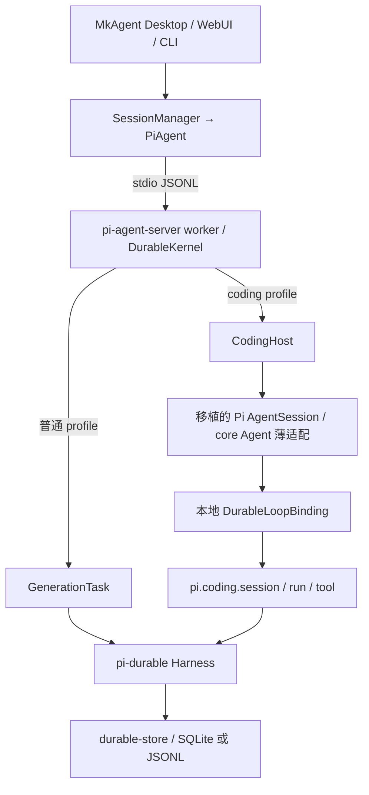

# Pi-durable coding agent 架构与纠偏边界

MkAgent 第一次将 Pi coding agent 直接换成 pi-durable 后，发现 Coding 能力不足且无法复用原插件生态。本次以切换前 MkAgent 的行为及接入边界为参照，保留 Pi coding agent 的 Coding 层，尝试以 durable 替换其底层执行基座。目标关系是 MkAgent 使用 Pi Coding 层，Pi Coding 层通过必要适配使用 durable；产品既有功能及后续有效修复继续保留。

2026-11-08 的纠偏先修正文档，再落实内核接入、Coding 兼容及相关代码和测试。此前大量复制并改造上游源码，带来 Coding 和 durable 每次更新时逐文件适配的维护风险。本次优先引用可复用 Pi 官方 SDK，减少长期维护的源码、生成转换和补丁；不能把本地算法移入 SDK 补丁就记作完成。MkAgent 既有整体架构、分层和宿主职责保持，调整限于必要内核接入。需求及 SDK 选择顺序以[能力规格](coding-capabilities-spec.md)为准，步骤见[纠偏跟进](coding-follow-up.md)。`pi-agent-core` 按需使用；完整 `pi-coding-agent` 包的现行生产依赖限制不要求复制其完整 SDK。

本文记录 `cb0311f` 的实际装配及后续核查。当前按能力划分的发布 API、补丁、适配、恢复边界和退出条件见[SDK 维护清单](coding-sdk-maintenance.md)。AgentSession、自有任务状态机、剩余 Native SDK 源码及补丁均属实现现状，未核实的必要性继续开放。下文的历史“保留”决定限定于当时选取的契约，不为整个模块提供永久保留依据。Marked 和 Highlight.js 是第三方资源包，其替换不计为 Pi 官方 SDK 复用。

## 目标职责与待纠正的实现选择

| 范围 | 目标与本次核对 |
|---|---|
| 执行、工具、存储和恢复 | 优先由 pi-durable 已发布实现承担；使用同一 Harness 只证明 scheduler 归属，仍须核对本地请求、工具轮次及收尾状态机的重复职责 |
| Coding 与插件 | 保留 Pi coding agent 的 Coding 层和公开插件契约，优先引用官方 SDK 实现；适配只处理接入 durable 及宿主策略的必要差异，不在 durable 上另行重建整套 Coding SDK |
| SDK 发布与仓内补丁 | 明确区分未修改发布包和补丁新增接口；core 操作导出、Agent 注入及 durable Coding hooks 等仍属本地维护负担 |
| 源码范围 | 从实际产品、公开插件和数据兼容需求推导；原版 Pi CLI、run modes 和插件组件分开核对，不由完整根导出反推需求 |
| 测试与恢复 | 保留权限、取消、错误、消息/输入身份、数据和不确定副作用保证；原型布局、getter 顺序和私有阶段需有契约或调用依据 |

官方执行器接入的未决差异包括插件事件时序、完整工具结果，以及 journal/host state 与 checkpoint 的事务关系。现有 `pi.coding.{session,run,call,tool,summary}` 五种 v1 任务有持久数据，迁移须处理各自的 kind、input、checkpoint 和 result，不能直接删除注册或假定官方 migration 能转换。summary 承接压缩、分支总结和 bug report，保留已完成响应及不确定请求禁止重发的语义。当前未有完成替代接线的证据，后续以实际契约和验证决定适配范围。

## 当前执行链路



[coding 包](../../packages/pi-durable-coding/package.json)独立于 MkAgent shared、server 和 UI，主要公开 `/native`、`/agent`、`/durable` 入口；[CodingHost](../../packages/pi-agent-server/src/coding-host.ts)把它接到产品 worker 已有的 Harness、工具目录和模型接口。

普通 profile 使用 `GenerationTask`；coding profile 通过 [DurableLoopBinding](../../packages/pi-durable-coding/src/durable-coding/engine.ts)运行 `pi.coding.session/run/tool` 等本地任务。宿主工具通过公开 `ToolTask` phases 执行；请求执行和 partial 写入现委托仓内新增 `GenerationResponseTask`，复用 SDK 既有 `streamResponse`。Native 保留插件事件、完整结果、工具轮次、收尾及 journal 交付，后续继续核对这些职责与官方执行器的边界。Native Agent 子类目前通过仓内 core 补丁接入 durable，不能将此现状直接认定为最终最薄架构。

独立 SDK 也能使用这一边界，但默认后端为 `MemoryStorage`。需要跨进程恢复时，调用方须提供持久 Storage；产品 worker 已接入持久存储。

### 请求执行的 SDK 接点

Pi 1.5.0 的 `GenerationTask.request` 会继续分类响应、写 assistant、创建工具和结算输入，没有独立返回响应的出口。Native 还须在 `message_end` 后读取插件最终改写的 calls，并为 `length` 中的每个 call 交付未执行错误。因此仓内新增 `pi.generation-response` v1，只执行已准备请求并返回消息，不分类、不写 transcript、不记 usage、不创建工具。它直接复用 SDK 的 `streamResponse` 和 partial writer，未复制另一份流算法，也未把 Native loop 移入补丁。这是本地 SDK 扩展，不是未修改发布包已有 API。

[请求适配](../../packages/pi-durable-coding/src/durable-coding/generation-response.ts)在真实 `pi.coding.run` owner 上调用新任务的 request/abort。core 继续处理 context 转换、凭据和协议事件；SDK 消费流并等待最后一笔 partial 提交，再允许 Native 交付 `message_end`。SDK receipt、Native journal 的唯一 assistant entry 和下一 checkpoint 同事务提交。只持久化准备后的 messages、model identity 和 thinking level；请求凭据、headers、回调及 provider options 保留在运行时闭包。

任务文档记录 SDK checkpoint 和结果，不注册第二个 scheduler。冷恢复遇到不确定 request 或事件时不重发，先由 SDK 的 started 重入路径结算 intent、清除 generation 槽，再保留 Native 的不确定交付错误。外部取消与 scheduler abort 均等待流清理，后者调用 SDK abort，不追加第二条 assistant。旧 `pi.coding.*` v1、`LoopInput.resume` 和原 `GenerationTask` v4 的阶段保持；已有恢复回归与三种新 SIGKILL 场景只证明各自覆盖范围，不代表全部历史迁移组合已验收。

升级时须重新核对 SDK `streamResponse` 的 runtime 参数、`codingStream.closed` 与 partial drain 顺序、新任务的声明及根导出。退出条件是上游提供可独立返回已准备请求结果的接口，并能保留上述事件及事务行为；达到条件后撤除新任务转换和对应补丁。工具轮次、finish、session、summary 与完整 Coding 闭包仍按 F1 至 F3 继续处理。

### 工具轮次与收尾的 SDK 边界

本次继续对照固定 Pi 1.5.0 的 [GenerationTask](https://github.com/earendil-works/pi/blob/f9a26365568127461c47a07a37dcb42c140a3ac5/packages/durable/src/harness/generation.ts)、[Native run](../../packages/pi-durable-coding/src/durable-coding/run-task.ts)及实际宿主接线。不能只因 checkpoint 或结果签名不同保留本地轮次；当前不能直接接入的原因是 SDK 阶段同时决定并提交以下行为。

| 边界 | 发布 SDK 的实际职责 | 当前必要适配及继续收敛条件 |
|---|---|---|
| 接纳工具 | `startToolRound` 写 assistant、创建官方 ToolTask、更新 LiveDoc 和 SDK run turns，再等待新任务 | Native 的 assistant 已在 `message_end` 后与 journal 提交，preflight 还须交付插件拒绝、改参及 `length` 的未执行结果。不能再次写 assistant 或重复接纳 effects；需要独立接纳出口，或包含 journal 和插件契约的明确迁移方案 |
| 等待和交付 | `GenerationTask.tools` 从 SDK assistant entry 查 pending calls，顺序创建后续 ToolTask，并进入内部 `finishToolRound` | Native 等待真实 owned 子任务，按源 call 顺序交付完整 content/images/details、插件事件和 journal。SDK 已承担宿主工具 effect、嵌套执行与 replay；剩余轮次适配不再复制这些执行算法 |
| 工具控制及续轮 | `finishToolRound` 调 `afterTools`，随后同事务应用 addTools、handoff reset、turn limit、inbox 和下一 GenerationTask 或结束 run | 全部 call 要求 terminate、最后 handoff 生效这两条规则与 Native 一致，不构成保留依据。缺口是不能独立返回决定，再让 Native 的 `finishTurn`、`turn_end`、steering/follow-up 及 journal 接受该决定 |
| 最终收尾 | `GenerationTask.finish` 承接 SDK run summary，运行 `afterRun` 和 owned task drain 后结束已回答 run | 不是 Native `finishTurn` 或 `agent_end` 的独立出口；Native session 的最终回执与输入身份仍须保持。不能靠隐藏 SDK 写入或伪造任务结果接线 |

产品 [CodingHost](../../packages/pi-agent-server/src/coding-host.ts)通过 `wrapTool` 将非 builtin 工具交给 [wrapAgentTool](../../packages/pi-durable-coding/src/host-tools.ts)；生产 builtin 使用宿主提供的 durable 工厂。现在 [DurableLoopBinding](../../packages/pi-durable-coding/src/durable-coding/engine.ts)也将公开 Agent/runToolCall 入口接收的普通 AgentTool 交给同一个 ToolTask 桥，已桥接工具直接复用。AgentTool 与 ToolDefinition 的两次转换保留桥接标记，避免 builtin 和 tool-search 重复接纳；此项本地生成转换没有增加 SDK 补丁。直接构造低层 CodingToolTask 的 fixture 仍可自供执行函数，不属于上述公开入口的自动接线范围。

Native 先准备并验证参数，再运行权限 hook；内部 SDK effect 桥不重复校验权限改参，实际 effect 开始前再次检查取消。最终执行参数与完整结果在同一 SDK receipt 中原子保存，正常交付和恢复均读取该快照；旧 receipt 缺字段时回退 Native 已接受的参数，宿主 `finalArguments` 回调仍优先。SDK 对不确定执行使用 `<harness>` 错误诊断，unsafe 工具仍不重跑。五种 Native 任务和 HostExecutionDoc 的版本保持不变。

本批不新增轮次或收尾补丁，保留上述交付与事务适配，不变更任何任务版本或历史 checkpoint。退出条件是公开 API 能承接已接受的 assistant 和外部 owned 工具结果，并把轮次决定交还宿主，或已验证的整体接线能保留相同插件、输入及持久化保证。上游升级须重新核对工具接纳、`afterTools`、`onYield`、`afterRun` 与输入结算的先后；该版本的缺口不证明整套 Native loop 永久必要。完整 Coding 闭包继续按 F1 至 F3 核对。

### Summary 与 session 的 SDK 边界

[Summary binding](../../packages/pi-durable-coding/src/durable-coding/summary-binding.ts)的 producer 复用现有 `StreamFn(...).result()`，本地 [summary task](../../packages/pi-durable-coding/src/durable-coding/summary-task.ts)只管理 ownership、请求 intent 和完整响应持久化，没有复制流消费算法。它承接压缩、分支总结及 bug report，动态模型、凭据和回调继续留在运行时闭包。

| 范围 | 候选 API 与实际缺口 | 当前适配及退出条件 |
|---|---|---|
| 内部 summary 请求 | 发布 GenerationTask 会分类、写主 transcript 和创建工具；CompactionTask 还包含上下文选取和 compaction entry 策略。仓内 GenerationResponseTask 虽可独立返回响应，但 request/abort 及 partial writer 都操作 conversation 级 `LiveDoc.generation` | 已有回归覆盖 summary 不覆盖主请求进度，未确认产品并发启动多个 summary 的调用。保留独立 owner、requesting checkpoint、完整响应回执及不确定请求不重发；待 SDK 提供任务级进度隔离或无 conversation 进度写入的响应接口，再验证动态路由、usage、取消及真实崩溃后替换 |
| Native session 生命周期 | 已复用 Harness task ownership、commit 和等待；GenerationTask 的收尾结算 SDK run，不能直接承接 Native 已接受 child、插件回调状态及产品回执 | [Session task](../../packages/pi-durable-coding/src/durable-coding/session-task.ts)同事务接纳真实 run child、journal/state 和下一 checkpoint。恢复只 join 已接受 child，不重做 prompt hooks 或不确定 post/before-settle/finalize/action。待公开生命周期接口可承接这些输入身份、回调和回执，或整体迁移通过等价恢复验证后撤除 |

本批仅新增 summary 并发进度隔离回归，未更改 summary/session 运行时代码或 producer 契约。升级须重新检查 progress 的写入位置、summary 的完整响应和 usage、session 的 child 接纳及回调顺序；历史五种 Native v1 任务继续可读。这些具体缺口不关闭 F1 至 F3，也不证明完整 AgentSession 源码或全部私有方法均有必要。

## 哪些直接引用上游包

以下是 coding 包和 [worker 包](../../packages/pi-agent-server/package.json)声明的 Pi 系直接生产依赖，均固定为 `1.5.0`；具体归属以两个 `package.json` 为准。根项目通过 `patchedDependencies` 修改 durable 和 core；下表的包引用不等于全部能力均来自未修改发布包。新增导出和执行接点必须按本地 SDK 例外核对。

| 包 | 用途 |
|---|---|
| `@earendil-works/pi-durable` | Harness、任务、事务、存储和恢复，以及生产宿主已安装的 `/codemode`、`/tool-search`、`/tools`、`/images` 内置模块 |
| `@earendil-works/pi-agent-core` | 已发布协议类型、消息声明合并、`streamProxy` 和 Agent 实现。八个操作导出、Agent 执行器注入及相关接点由仓内四文件补丁增加，属于待核对的本地修改 |
| `@earendil-works/pi-ai` | 模型目录、provider、消息、流式请求、用量、内存模型存储、枚举 schema 内容、usage 总数及公开取消和等待 helper；旧接口保留所需的类型、signal 与取消错误适配 |
| `@earendil-works/pi-mcp` | MCP 客户端与协议支持 |
| `@earendil-works/pi-codemode` | QuickJS 沙箱，作为 durable codemode 的执行后端 |
| `@earendil-works/pi-tui` | Pi 交互组件、主题和终端接口 |
| `@earendil-works/pi-schema` | schema 与类型支持 |
| `@earendil-works/chord` | 结构化数据、执行上下文等基础能力 |

根仓库、shared 和 server-core 仍声明 `pi-ai 1.1.0`，不在上表 Coding 版本范围内。任务版本也须区分发布包与仓内补丁：

| 标识 | 未修改 Pi 1.5.0 | 当前本地安装 | 兼容核对 |
|---|---|---|---|
| `pi.generation` | GenerationTask v2 | 仓内补丁升为 v4，加入 Coding 阶段与 hooks | 本地 v4 checkpoint 不能直接交给未修改 v2；核对 input、checkpoint、已接受输入及结果 |
| `pi.generation-response` | 不存在 | 仓内新增 v1，仅执行准备后的请求并返回响应 | Native owner 的 task document 保存 SDK checkpoint；started 重入只结算，不重发请求 |
| `pi.tool` | ToolTask v3 | v3，未在本补丁中改任务版本 | 该 kind 的迁移不能自动转换 `pi.coding.*` v1 |
| `CODEMODE_MODULE_VERSION` | 2 | 仓内补丁升为 3 | 这是 codemode replay module 版本，不是 ToolTask 或文档 schema 版本；存量日志须按实际版本处理 |

发布定义见锁定 [GenerationTask](https://github.com/earendil-works/pi/blob/f9a26365568127461c47a07a37dcb42c140a3ac5/packages/durable/src/harness/generation.ts)、[ToolTask](https://github.com/earendil-works/pi/blob/f9a26365568127461c47a07a37dcb42c140a3ac5/packages/durable/src/harness/tool.ts)及 [codemode](https://github.com/earendil-works/pi/blob/f9a26365568127461c47a07a37dcb42c140a3ac5/packages/durable/src/codemode/codemode.ts)。本地改动以[仓内补丁](../../patches/@earendil-works%252Fpi-durable@1.5.0.patch)为准。主链替代须同时覆盖五种 `pi.coding.*` v1 与上述历史内核状态，不能仅比较安装包导出的名字。

这两个包没有直接依赖完整 `pi-coding-agent`。Coding 包直接引用 core 的公开类型和代理传输，避免维护对应源码副本；`jiti`、`typebox`、`quickjs-wasi`、图像和文本处理等其他依赖也直接使用 npm 包，完整版本见 coding 包清单。

内存模型存储通过同名 Native 子类继承公开 `InMemoryModelsStore`，保留已测克隆、取消和子类调用，方法所属原型及基类身份有所变化。Native `StringEnum` 保留自己的 `TUnsafe` 签名和 TypeBox 实例，包装公开 builder，保留非枚举标记、数组克隆及字面量推导。上下文 usage 总数直接引用 `pi-ai/utils/estimate`。三份源码共减少 34 行；生成规则按原声明摘要拒绝上游漂移。

无 Native journal 的 Agent 冷恢复从实际 checkpoint 重建消息数组，普通新任务保留原有消息对象；journal 路径继续由原身份映射负责。恢复先核对任务存在性、种类和会话，再确认初始历史已持久化，避免后续 prompt 重复写入。绑定回调抛错时也释放活动执行状态。真实 SIGKILL 只覆盖该独立 Agent 的工具执行边界，不代替完整产品与 Native journal 恢复验收。

实际任务记录的回归拒绝其他会话与错误种类，同时接纳本会话的 session 子任务，未要求其直接归会话所有。子任务测试在绑定回调处终止；同一已装载 Agent 的已完成任务也能加入且不再请求模型。这些检查验证恢复入口的校验，不替代完整会话生命周期。

ZIP 写入已转发到[归档适配](../../packages/pi-durable-coding/src/compat/archive.ts)。`fflate@0.8.2` 负责 ZIP 文件记录和目录，原有 DEFLATE 与 CRC 继续使用 Node 标准库。公开 `ZipInputFile` 接口保留输入顺序和重复文件名，也避免为每个条目保留压缩窗口。工具安装器等待 `JSZip@3.10.1` 完成 CRC 校验和普通文件解包，保留二进制查找、安装及清理流程。JSZip 规范化后保留同名的最后条目；适配要求独立空目录，在写入前检查保留条目的路径和文件类型。被覆盖的原始条目及实际 Windows 行为边界见[验证记录](coding-validation.md)。

Native EXIF 方向处理已转发到[图像方向适配](../../packages/pi-durable-coding/src/compat/image-orientation.ts)。durable 补丁开放既有的元数据读取和像素转置 helper，Native 兼容参数保留 WebP 块边界、短块前缀判断、有符号块长度及小端 TIFF 偏移，默认解析行为保持原样。适配使用与 durable 相同的公开 Photon 0.3.3，保留翻转时的对象身份和转置时由调用方释放旧对象的契约。

Native 缩放核心也转发到[缩放适配](../../packages/pi-durable-coding/src/compat/image-resize.ts)。编码与逐步缩小由 durable 共用循环负责，回调调用共享 Photon；兼容参数保留原质量阶梯、PNG/JPEG 选择和严格大小比较。适配保留分步尺寸取整、原字节早退、结果元数据及 worker 协议，原包默认工厂与 Native 各有独立旧结果基线。同步 PNG 核心继续直接调用公开 Photon，durable 薄包装的 14 组对照没有发现可减少的算法。

Native Photon 入口现只转发到[共享加载适配](../../packages/pi-durable-coding/src/compat/photon.ts)，通过公开 `initSync` 初始化同一包实例，不再替换全局 `fs.readFileSync`。生产清单统一为 `@silvia-odwyer/photon@0.3.3`，旧 Node 包仅用于开发测试中的原版对照。构建脚本只选择 `photon_rs_bg.wasm`，并清除旧构建留下的专用 WASM。生成器检查两个公开声明，不再绑定已删除加载器的私有正文。Node 搬迁包和 Bun 独立可执行文件已通过单资源及缺失资源检查，完整产品发布与终端注册仍未重验，具体范围见[验证记录](coding-validation.md)。

规范依赖补丁现在包含 30 个文件，首行记录后续正文按 LF 换行计算的完整 SHA-256。更新补丁时须同步摘要；回归用例检查两者一致，以免复用旧 Bun 缓存产物。[完整生成器](../../packages/pi-durable-coding/scripts/patch-generation-response.ts)只重建 generation 及根导出的四个产物，保留其余补丁段，并对 pristine 副本执行完整 `git apply --check`、实际重放及全部 30 个输出核对。`DURABLE-PATCH.json` 记录全部文件的原始和目标哈希。本轮全新消费者在禁网、禁用 lifecycle scripts 的冻结安装后逐一匹配这 30 个输出；缓存与锁文件准备过程见验证记录。

Native 图像 MIME 识别通过[类型适配](../../packages/pi-durable-coding/src/compat/image-mime.ts)共用 durable 的既有头部解析算法。适配仅保留未识别时的 `null` 和文件前 4100 字节的读取窗口，完整文件读取器的 APNG 扫描范围与原生入口不同，因此继续使用内核的字节检测函数。私有剪贴板图片读取入口已在后续宿主残留清理中删除。

Native ANSI 完整匹配通过[薄适配](../../packages/pi-durable-coding/src/compat/ansi.ts)引用 `ansi-regex@6.2.2`，仅补齐私有 CSI 前缀，并在同一次替换中处理所有匹配，避免删除后拼成新序列。原入口保留类型错误、快速路径和 256 个 UTF-16 码元的流式残片上限，两个导出函数的正文与上游相同。该公开包没有传递依赖，旧调用方继续解析到原来的 `ansi-regex@5.0.1`，具体对照和冻结安装范围见[验证记录](coding-validation.md)。

Native 子进程等待通过[薄适配](../../packages/pi-durable-coding/src/compat/child-process.ts)共用 durable 的既有算法。等待函数及类型通过 `env/node` 补丁公开，算法正文保持原样。适配保留 Native 的退出码返回值和原来的无写盘队列等待策略，100ms 输出空闲期限、持续输出续期、继承管道释放及监听器清理由内核负责。进程启动继续使用 Node 和 Windows `cross-spawn`，不另建执行环境或调度循环。

Native shell 的 Bash 传参选择和进程树清理也通过[薄适配](../../packages/pi-durable-coding/src/compat/shell.ts)共用 durable 的既有函数。Native 保留同步查找、错误、PowerShell、环境和 detached 子进程集合；macOS 的组 `SIGSTOP` 策略在适配中保留，后续清理由内核执行。`env/node.js` 相对原包仅增加三个函数的公开导出，全部算法正文不变。局部生成检查和冻结消费证据见[验证记录](coding-validation.md)。

Native 同步与异步读取路径通过[薄适配](../../packages/pi-durable-coding/src/compat/read-path.ts)共用 durable 的候选生成器。截图空格、NFD 和弯引号规则只保留一份；Native 仍按需计算候选，跳过与原路径相同的候选，并保留其他候选间的重复探测。durable 默认入口仍先生成全部候选，再用 `Set` 去重。生成器默认复用首次 NFD，durable 显式选择重新计算，保留其原来的两次调用及首次探测前的错误。两种入口继续使用各自的路径解析和存在性检查。

Native 头、尾截断均使用原有公开 `chord/output`，[薄适配](../../packages/pi-durable-coding/src/compat/truncate.ts)集中保留 Native 的字节、行数、标签、getter、首行拒绝及部分尾行策略。默认上限和行计数留在外部适配层，大小显示保留 Native 的三条规则。两个 SDK 截断文件保持原始缓存内容，截断专有导出补丁已撤掉；该批截断改动完成时 durable 补丁为 28 文件，其余 26 份差异不变；请求切片后的完整补丁为 30 文件。生成转换只检查两个截断入口的公开签名和剩余私有 helper 引用，不再绑定头、尾的算法正文。相同 7 个类型根从 437 个文件降至 225 个，未发现诊断。中间和单行处理仍保留原文。两个运行时的原版行为、冻结消费者及首调用开销见[验证记录](coding-validation.md)。

Native [编辑差异入口](../../packages/pi-durable-coding/src/pi/core/tools/edit-diff.ts)通过仓内 durable 补丁导出的 9 个函数共用匹配、替换、换行和 diff 算法，18 个重复算法正文被移除。Native 保留自己的函数签名和类型声明，插件接口扩展仍作用于返回类型；文件解析、读取权限、BOM、预览和错误转换继续由原来的两个预览函数负责，正文不变。该补丁部分仅新增导出，既有算法及类型不变；两套 diff 的 19 份运行时文件一致。源码由 556 行降为 186 行，原版结果、真实文件预览及冻结消费者范围见[验证记录](coding-validation.md)。

插件 [edit 工厂](../../packages/pi-durable-coding/src/pi/core/tools/edit.ts)的参数转换现直接引用公开 `@earendil-works/pi-durable/tools` 的 `createEditTool().prepareArguments`，删除本地转换函数、单个 edit 判断和两个辅助类型，无新增补丁。JSON 字符串、单个对象、旧顶层字段及混合输入由 SDK 处理，原始 call 参数保持不变；core 使用返回参数继续校验。Native 文件操作、权限、队列、取消、renderer 及公开 TypeBox 类型保留。升级只需核对该公开 callback 的返回形状与实际编辑行为，不再逐项维护转换算法。此前完整 edit 执行适配的保留评估仍限于当时范围，不能覆盖本次已删除的参数副本。

版本范围需要分开看：[根包](../../package.json)和 [shared](../../packages/shared/package.json)仍声明 `pi-ai@1.1.0`，不能把 coding 运行时的 `1.5.0` 写成全仓统一版本。

宿主的 `tools/codemode.ts` 直接调用 durable 的 `createCodemodeExtension`，`index.ts` 安装内置 `createToolSearchExtension`；`tools/builtin.ts` 使用 durable 的编码工具、PowerShell 和图像工厂。`CodingHost` 将 registry 中的注册转换为原生工具，并通过 `baseToolsOverride` 注入 coding 会话。上述装配已有实现，本轮补充核实。

真实沙箱回归发现 Worker 回调丢失异步上下文，导致桥接提交报错。`currentCodingToolInvocation()` 现在捕获当前上下文，使后续提交回到原来的工具和 journal 作用域；codemode 的执行、日志和子任务仍使用 durable 内置实现。三项集成检查覆盖子工具审批与归属、model-only 限制及 tool-search 启用回调。完整 AgentSession 的声明更新、分支和恢复不在这三项检查范围内。

SDK 的 tool-search 已共用 durable 的分词、BM25 和 schema 元数据遍历。仓内补丁为现有核心增加兼容导出，提供 SDK 所需的分数、可配置 `k1/b` 和元数据文本；内置工具仍调用同一排序核心，默认行为保持原样。SDK 保留 namespace 独立字段、注册和会话启用接口，不另行维护排序算法。兼容导出属于本地补丁，升级须重放补丁并运行原版排序对照。

原生 codemode 入口现已转发到 `src/compat/codemode-native.ts`，原来的独立执行循环已删除。VM 执行、调用日志、四个模型并发槽及结果提交由 durable 内置执行器负责。Native 适配保留字符串调用 ID、实时行、模型目录、发现元数据、分支 store 和文件写入策略；输出仍共用内置 formatter，保留此前 96 个原版格式化对照场景的证据。

一个隐藏转发工具把 VM 调用接到真实官方子任务，再由 Native `ctx.executeTool` 进入既有工具管道。它保留实际 task ID、owner、调用 key 和审批回调，不伪造 Native invocation。私有注册名固定从原工具名派生，目录变化不能改变旧调用的目标，无须另存别名表。转发 token 使用 memo 的持久胜出值，同一 owner 只允许一个活动租约。回执保存 Native 行元数据，重用已完成结果时恢复 ID、状态与展示 usage；已记录的准备拒绝也不会重新查询模型目录。用量去重标记在 Native 任务中保存为收据元数据，读取时恢复，保留严格 JSON 边界及 wrapper spread。

Native store 首次读取和最终写回分别进入 `run.start` 与 `run.result` 的事务；配置适配器后不写内置会话 store。实际 Native 入口与真实分支 journal 的检查覆盖分支切换、原始写入、无 append、结果重用、脚本错误、回调拒绝及存储拒绝。存储错误终止 Harness，不在同一会话自动重试。沙箱适配保留 256 MiB、默认两个 worker、FIFO 和等待期限，实际 worker 退出后才释放名额。上述边界已有定向证据，完整插件加载、产品入口及进程崩溃恢复仍未重新验证；Native 父工具默认的 unsafe 回放规则保持不变。

`pi-durable` 通过根包的 `patchedDependencies` 应用[仓内补丁](../../patches/@earendil-works%252Fpi-durable@1.5.0.patch)，包含旧 `GenerationTask` coding 阶段、回调、类型声明及上述搜索和输出兼容接点。当前生产 `CodingHost` 通过本地任务执行；根 SDK 仍公开旧 `NativeCodingRuntime`，历史 checkpoint 也保留读取及拒绝不确定回放的迁移语义。删除旧阶段部分须先完成兼容桥接及存量恢复验证；搜索和输出接点单独保留升级核对。

补丁统一由干净依赖生成标准 Git diff。Native codemode 阶段的 18 个文件通过干净缓存重放及全新消费者的离线 frozen install 字节核对；安装禁用 lifecycle scripts，系统沙箱拒绝网络，锁文件未变。该阶段消费者通过 29 项测试、150 个断言，后续 28 文件及本轮 30 文件核对分别见验证记录。兼容接点仍属于仓内补丁，升级须同时核对补丁重放、新安装和 Native 行为，不能只核对已修改的安装副本。

历史 `scripts/patch-durable.ts` 只负责四个 harness 文件，不能重建完整补丁。默认模式只新建不存在的补丁，拒绝覆盖任何现有内容；写 SDK 产物和清单前独占创建补丁，防止预检查后出现的新文件被覆盖。`--check` 保留历史四文件范围的只读比较，拒绝缺失或无 Git 文件头的补丁。完整补丁在两种模式下均于 Git 调用、类型分析及写入前被拒绝。Bun、Node 各通过 18 项历史回归，CLI 夹具和实际入口检查通过。新的 30 文件生成与重放由 `patch-generation-response.ts` 负责，不能用历史四文件生成器替代。

## 哪些复制或移植了上游源码

两套移植均固定到 [Pi v1.5.0](https://github.com/earendil-works/pi/tree/f9a26365568127461c47a07a37dcb42c140a3ac5)，完整 revision 为 `f9a26365568127461c47a07a37dcb42c140a3ac5`。

下表路径相对于 `packages/pi-durable-coding/`。

| 本地位置 | 上游来源与移植方式 |
|---|---|
| `src/pi/**` | 从 `packages/coding-agent/src/**` 保留的 Coding SDK 源码，共 193 份 TypeScript 和 6 项主题及 HTML 导出资源。排除原版 CLI、三种 run mode 宿主及已核实的私有残留；保留 `AgentSession`、SDK 工厂、工具、扩展、资源、RPC client/协议和插件 UI 组件，部分文件经过适配。 |
| `src/durable-agent.ts`、`src/stream-fn.ts` | Agent 由 662 行移植实现改为 105 行 core 子类，保留 durable 队列身份、恢复和独立的可变默认对象。默认消息转换直接使用发布版 core；模型和 usage 两个默认对象仍从锁定上游提取，stream 模块保留独立注册状态。`src/agent-runtime.ts` 和 `src/stream-proxy.ts` 使用公开包适配。 |
| `src/native-operations.ts` | 22 行门面，调用仓内 core 补丁导出的 8 个请求、工具参数准备及结果处理函数。保留 Native 默认身份对象，调度循环由本地任务实现。 |
| `src/rpc-ui.ts` | 从上游 RPC 类型中抽取扩展 UI 请求和响应声明，使宿主可单独引用协议。 |
| `src/upstream/**` | 6 项选取源码：旧扩展 loader、Git 路径、上下文文件、资源去重、boundary drafts 和同步 durable context；另有 28 个共享入口。旧 loader 共用 Native 的 runtime、注册 API 和 factory 生命周期；资源纯函数也由原生模块复用。 |
| `test/fixtures/upstream/**` | 6 个原样测试夹具：5 个公开示例插件和 1 个 MCP OAuth 测试服务。 |

前四行合计为 [UPSTREAM-RUNTIME.json](../../packages/pi-durable-coding/UPSTREAM-RUNTIME.json) 的 197 份源码和 6 项资源，转换规则由 [vendor-coding-runtime.ts](../../packages/pi-durable-coding/scripts/vendor-coding-runtime.ts)管理。本批定向复现全部 192 份允许的 Coding 源码，核对 6 项资源的来源及产物摘要和 4 个门面的产物摘要；没有读取受拒绝的 token 文件、重新生成门面或重算完整闭包。后两行合计为 [UPSTREAM.json](../../packages/pi-durable-coding/UPSTREAM.json) 的 12 项来源产物及 28 个共享入口，由 [vendor-upstream.ts](../../packages/pi-durable-coding/scripts/vendor-upstream.ts)生成。两套清单可能引用相同上游文件，计数代表本地产物。

`461e7c9` 后的入口核对确认，MkAgent 通过 `CodingHost/createAgentSession` 装配，仓内产品没有 `main`/`MainOptions` 调用。先前切片排除原版 Pi 启动器及其独占的 24 份源码，包含 CLI 认证、配置向导、自更新、旧 Pi 配置迁移和 CLI 内置扩展集合；Llama 管理扩展仅由该集合进入。`5662422` 后的限定复核另确认，原始 MkAgent 和当前宿主均自行管理会话、UI 与传输，不依赖上游终端、stdout 或 stdin/stdout RPC 模式宿主。现从根入口和 modes barrel 排除 `InteractiveMode`、`InteractiveModeOptions`、`runPrintMode`、`PrintModeOptions`、`runRpcMode`，并删除三个实现文件。生成规则在遍历任一入口的依赖前完成排除。`RpcClient` 及其 options、RPC 协议、`JsonAgentSessionEvent`、Theme、CustomEditor、renderer/UI、`ExtensionMode`、AgentSessionRuntime 和插件生命周期保留；MCP/codemode/tool-search 的公开工厂保留。直接使用被排除模式的外部消费者须迁移到自有宿主，这项导出变化不承诺任意外部消费者零影响。此处删除不需要的模式宿主，不计作官方 SDK 完整覆盖，也没有证明其余辅助闭包全部必要。

模式宿主删除后，`modes/interactive/bug-report.ts` 的终端同意、上传和 ZIP 交付界面没有剩余调用，也未从根入口公开导出；`core/bug-report-upload.ts` 只供该界面使用。两份源码及来源记录已删除。生成器已在两个入口切断模式宿主依赖，不需再加替代实现或排除规则。`core/bug-report.ts` 和 `AgentSession.summarizeForBugReport()` 仍供会话摘要使用，继续保留。宿主实际调用摘要和双包名插件的 11 项回归、声明构建通过；不调用真实 provider 或上传服务。这是宿主私有界面范围删除，不是官方 SDK 替代，也不支持批量删除公开插件组件。

`d913008` 后继续核对并删除四份无剩余调用、未从包入口导出的终端私有 helper：`session-share.ts`、`chat-viewport.ts`、`tui-renderer.ts`、`program-status-reporter.ts`。它们分别装配上游分享交付、viewport、终端 renderer 和状态上报，不是公开消息或工具 renderer 组件。既有模式入口排除已切断这些依赖，未新增替代实现；来源清单同步删除四项。`external-editor.ts`、`model-search.ts` 和 `model-catalog-refresh.ts` 仍被公开组件使用，继续保留。双包名插件和宿主 UI 的 29 项回归、声明构建及独立 `./native` 声明消费者通过；不调用分享服务或已登录身份。该项仍是宿主范围删除，不作为 SDK 替代或完整闭包核验。

`20cb6e8` 后再删除 15 份无剩余调用、未从根入口或组件 barrel 导出的私有源码：`cli/auth-command.ts`、`core/radius.ts`、`core/cache-stats.ts`、`utils/changelog.ts`、`utils/version-check.ts`、`utils/clipboard-image.ts`、`theme/theme-controller.ts`，以及交互组件 `custom-entry`、`earendil-announcement`、`easter-egg-3d.lazy`、`easter-egg-3d`、`mermaid`、`pi-logo`、`radius-login-selector` 和 `themed-text`。此处 theme 和组件路径相对 `modes/interactive/`。公告专用 `clankolas.png` 和 `grok-mermaid` 依赖也移除；生成器和 worker 不再收集交互图片目录。公开 `Theme`、`CustomEditor`、renderer/UI、RPC、会话生命周期及 MkAgent 自有剪贴板和用量功能保留。定向行为、声明、消费者和 bundle 通过，来源记录仅删除对应项；不是 SDK 完整覆盖，也不证明所有保留源码必要。范围和未完成检查见[验证记录](coding-validation.md#private-host-remnants-after-20cb6e8)。

`06d1346` 后的核对确认内部组件 barrel 还带入 `FirstTimeSetupComponent`、`ScopedModelsSelectorComponent` 和 `TrustSelectorComponent`。三个类及其专用类型未从包根公开，路径、类型和符号检查没有发现保留调用。现从 barrel 排除并删除三份实现，生成器在依赖遍历前应用同样排除，缺失或重复上游导出时拒绝继续。公开 `ModelSelectorComponent`、Theme、CustomEditor、renderer/UI 及宿主信任处理保留。来源清单同步删除三项并更新 barrel 的转换记录；该清理不计为 SDK 替代，也不覆盖外部对私有文件的直接导入。验证范围见[验证记录](coding-validation.md#private-components-after-06d1346)。

`RpcClient` 是另一个程序化入口，不包含 agent 启动器。调用方须在 `RpcClientOptions.cliPath` 提供兼容的 Node CLI；`start()` 在缺少入口时于创建子进程前明确拒绝，不再运行工作目录下的 `dist/cli.js`。原注释声称会搜索入口，实际仅使用固定相对路径，现已修正。显式入口保留 cwd、env、provider、model、额外参数和 JSONL 请求，未恢复原版 CLI。Bun 和 Node 的本地进程夹具覆盖启动、请求、错误及停止，定向来源复现见验证记录；这不证明整个程序化运行模式闭包必要。

同一 args 模块中的 `printHelp`、`normalizeSessionName` 及三个专用导入也已删除。它们只服务于已移除的启动器，没有剩余调用，也未从公开根入口导出。`Args`、`parseArgs` 的公开导出和 model-resolver 使用的 `isValidThinkingLevel` 保留；生成规则逐项检查删除边界。参数解析、thinking 后缀、模型 ID 冒号和插件回归已验证，固定上游的单文件复现与声明构建通过。此项继续排除启动器残留，不记作 SDK 替代，也不证明整个 args 模块或运行模式可删除。

HTML 导出的 Markdown 和高亮副本已删除，分别直接依赖 `marked@18.0.11` 与 `@highlightjs/cdn-assets@11.9.0`。Marked 读取公开 `package.json` 声明的 browser 入口，去掉 source map 注释后与原副本的 44,640 字节相同；[Highlight.js 资源包](https://registry.npmjs.org/@highlightjs%2Fcdn-assets/11.9.0)提供的 `highlight.min.js` 与原副本的 121,727 字节完全相同。两者共用 22 行[资源适配](../../packages/pi-durable-coding/src/compat/html-assets.ts)，构建继续写入离线资源目录，高亮文件额外携带完整 BSD 许可注释。Native 模板、CJK 扩展及 renderer 配置保持原样；搬迁产物在禁止网络及读取 workspace 依赖目录时完成两条真实导出路径，移除新增许可注释后与原资源基线的 HTML 相同。现有服务端 `highlight.js@10.7.3` 不能代替 11.9.0 的 browser 资源，故新增独立资源包。具体范围见[验证记录](coding-validation.md)。

三处 pi-ai 收敛前的静态快照覆盖其中 245 份 TypeScript，按逐项核验的路径读取本地与上游源码。忽略注释和模块目标后，206 份语法相同，4 份生成的 JavaScript 相同，35 份仍有差异；3 个解析边界保持未分类。模块目标核对另确认 1014 个相对引用指向同源登记，484 个包或标准库引用不变，5 个模块增强不变。Agent 循环、AgentSession 的工具执行和插件 core 命名空间有意改接本地 durable；仅余的未登记相对类型重写是 stream 模块的公开 `StreamFn` 别名。这些分类不作为最新计数，也不证明完整行为等价或全部源码必要。

此前三个运行模式曾恢复上游 `process.off` 写法并验证监听器清理；该切片是历史证据。三个模式实现现已删除，不再以监听器转换作为保留理由。`node-process.d.ts` 仍提供环境类型补充，历史定向范围见[验证记录](coding-validation.md)。

请求及工具操作不再复制函数正文。core 补丁仅修改发布的 JavaScript 和类型声明，公开八个实际使用的函数，并为流式请求补充可选默认身份参数。Native 保留原来的身份对象，其他七个函数直接转发。本轮移除 `withToolChanges` 和 `prepareToolCallArguments` 的无调用转发及新增导出，这两个 helper 继续由 core 内部调用，不扩大补丁的公开 API。独立消费者须同时应用根目录登记的 durable 与 core 补丁。原版 58 场景保留为历史对照；本轮实际 task 回归、四文件干净补丁重放和独立 frozen 消费者的 Bun、Node 运行均通过，完整 SDK 声明及全仓类型的最终结果见验证记录。

Agent 的状态初始化、提示输入、事件归约、取消和等待也改由 core 类处理，Native 仅保留 durable 接点。core 的新增运行时正文净增加 4 行，不将原有类复制进补丁。默认消息转换已直接使用发布版 core，并删除补丁中的 converter 默认字段。模型、usage 和请求 identity 是可变对象，本批未把它们与无状态 converter 一并删除。执行后端沿用 core 的普通字段写法；透明 `Proxy`、构造函数参数个数和 getter 顺序仅是历史测试证据，未找到依赖这些细节的产品调用方，不作为保留执行分叉的条件。原版对照及冻结消费者的时点和范围见[验证记录](coding-validation.md)。

Native 实例仍满足 `instanceof Agent`，现在也满足 `instanceof CoreAgent`。两个构造函数的 `length` 均保留为 1；core 新增参数使用默认值，避免改变原有参数个数。私有字段和原型反射布局有变化，定向行为对照不代表这些内部布局完全相同。

`src/legacy/**` 单独维护 7 份宿主兼容策略。旧包管理、消息、模型、设置、token、会话及 runner 路径只生成转发，生成器不再保存这些策略的第二份文字模板。它们复用移植实现，不计为直接引用独立公开包。

这里的“移植”包含原样复制和可复现转换。清单记录原文件哈希、产物哈希及变更；转换覆盖 Agent 执行边界、宿主模型与凭据接口、项目信任、资源策略、工具回放、OAuth、插件解析及打包资源路径。转换规则保存在生成脚本及同目录的 `*-port.ts` 中。

上游复制部分保留 [MIT 许可](../../packages/pi-durable-coding/LICENSE.pi)，MkAgent 包声明为 Apache-2.0。构建时随依赖搬运的 WASM、Marked 和 Highlight.js browser 文件另行管理，不包含在上述 6 项 Pi 资源计数中。Marked 保留包提供的版权与许可注释，Highlight.js 另附包提供的完整 BSD 3-Clause LICENSE，单文件 HTML 也携带该声明。

## MkAgent 自有适配层与边界

`src/durable-loop.ts` 和 `src/durable-coding/**` 实现执行桥接、任务状态机、输入队列和 journal。[NativeSessionJournal](../../packages/pi-durable-coding/src/durable-coding/session-journal.ts)把原生会话条目、分支、输入身份和状态与任务 checkpoint 放进 durable 事务。[原生会话投影](../../packages/pi-agent-server/src/storage/native-session-projection.ts)及产品历史据此同步；投影失败会阻止继续发布，恢复不能只依赖一份普通聊天记录。对副作用不确定的阶段按回放策略拒绝自动重做，外部副作用不具备与本地事务一起提交的原子性。

同一事务内重复准备 journal 时，只应用该阶段尚未准备的操作；事务草稿 nonce 识别已准备前缀，回滚后的新事务从完整待提交操作重试。宿主工具 commit 在捕获的调用作用域执行回调，并在回调前后 flush，使回调新增原生条目与宿主文档共享回执。条目直到存储确认才进入已提交视图，回调自身的外部副作用仍由宿主管理。

宿主工具的执行由 [host-tool-task.ts](../../packages/pi-durable-coding/src/host-tool-task.ts)委托原包公开的 `ToolTask.definition.phases.call/execute`，取消后的新 invocation 委托 `ToolTask.definition.abort`。SDK 负责真实 `ToolExecutionApi`、输出窗口与节流、嵌套 admission、replay 判断及嵌套工具清理；旧 `host-tool-nested.ts` 副本已删除。适配器在 `pi.coding.tool` owner 的 task-scoped 文档中保存 SDK 版本、input、checkpoint、完整 Native 结果及 SDK failure，不另建根级 `pi.tool`，也不写第二份 transcript。SDK 的嵌套子工具仍是真实 `pi.tool` 任务。

外层保留 Native preflight、`afterToolCall`、`tool_execution_*` 和 journal 事务。完整 Native 文本、图片、details、structuredContent、control 与 usage 通过私有 JSON envelope 保留；普通 host 输出使用 SDK 的有界结果与诊断。Native hook 可改写 usage，因此根级用量在 hook 后由原 owner 入账，已入账的嵌套用量以收据标记恢复。旧 v1 checkpoint 没有新文档时保持原 replay 路径；新 intent 的重放同时受 Native 已记录/当前策略及 SDK 已记录/当前策略限制，任何一项不安全都由 SDK 结算而不重跑。已完成 SDK 结果可在工具移除后恢复。进行中的同 owner 调用明确拒绝，事务内再次核对调用身份；工具返回并等待已接受操作后关闭捕获的 API 和会话 handle。外部取消停止 effect，但 SDK 使用仍有效的任务上下文完成结算；scheduler abort 先 join 执行，再进入 SDK 清理和 Native 交付。

SDK terminal failed 也随结果持久化。Native hooks、事件和 journal 完成后，真实 owner 以 failed 结束，由官方 scheduler 取消并等待普通 owned tasks 及 owned conversations 内的任务。仅成功交付的 SDK 失败结果带有内部收据标记，单工具和模型轮次调用方据此接收完整结果；hook 或事件交付失败继续走各自错误边界。SIGKILL 恢复覆盖该失败回执及工具移除后的清理。

该接点不增加 SDK 补丁或依赖。升级时核对公开 phases/abort、`TaskRuntime.commit`、`NestedCallDoc`、`LiveDoc` 进度槽和 ToolTask 版本迁移，运行崩溃、取消、完整结果及 journal 回归。若上游提供可保留 Native 原始结果和同事务回执的直接委托接口，应以该接口替代文档与 runtime 适配。当前替换只覆盖宿主工具执行；请求和工具轮次、session、summary 及完整 Coding SDK 闭包仍在 F1 至 F3 范围内，不能据此宣布整体纠偏完成。

`src/host-*.ts` 与 worker 的 `CodingHost` 接管路径、设置、模型接口、工具包装和 UI。`resourcePolicy: 'native' | 'host-only'` 控制自动资源发现，与执行模式分开；`host-only` 仍可使用显式宿主资源。项目扩展及 `.pi/mcp.json`、`.mkagent/mcp.json` 共用宿主信任决定，工具调用继续经过 MkAgent 审批。受信任 Node 插件拥有进程能力，工具审批不构成插件沙箱。

宿主压缩窗口由 `host-settings.ts` 包装公开 `SettingsManager` 接口，在内存中合成实际模型的 reserve tokens；原生设置实现不再带宿主策略补丁，reload 和 flush 不把该策略写入 Pi 配置。插件转译通过 Jiti 公开 transform 与 Babel 插件接口修正 Bun 的 `import.meta.dir/path/file`，按源文件提供元数据并隔离旧转译缓存；两个加载入口共用适配，保留宿主及插件的堆栈格式化。

插件保留 Pi 包名导入，由[原生虚拟模块表](../../packages/pi-durable-coding/src/pi/core/extensions/virtual-modules.ts)映射到本地移植 API 和独立官方包，也提供旧 `@mariozechner/*` 名称映射。这不要求安装完整 coding-agent 包。MkAgent 通过 RPC 承接扩展 UI；保留 Pi TUI 源码和依赖，不代表 MkAgent CLI 已采用原生 Pi TUI。插件兼容范围以需求对照中的实际验收为准。

两个 loader 现共用 `createExtensionRuntime`、`createExtensionAPI`、`createExtension`、`initializeExtension` 和 `loadExtensionFromFactory`。旧入口的生成器删除这五个函数正文，转而引用 Native loader；仅在私有模块导出 initializer，没有增加公共 SDK 根导出。原先将初始化状态视为无法共用的依据过宽，实际状态由每次调用持有，不依赖模块映射或缓存。Native 继续提供 Coding SDK，旧入口仍映射到 compat 并拒绝旧 Agent 执行与私有子路径回退。两者的模块缓存、cwd 和 generation 继续独立，目录策略保持原值。独立公开 API 尚未提供这一 Coding loader，本批只去掉本地重复实现，没有增加依赖、SDK 补丁或改变持久化任务。上游更新须核对五个声明、注册事务、失效 API、模块映射及缓存隔离；当公开 API 能接纳两套模块表、缓存和目录策略时，再撤除剩余加载适配。

Pi v1.5.0 尚未将 `AgentSession` 及 Coding 专有的扩展和资源装配独立发布；durable `/tools` 已提供 read/write/edit/bash/PowerShell 及 coding 工具工厂。完整 coding 包的 `createAgentSession` 固定创建上游 Agent，未公开此处所需的执行器注入及版本化 snapshot/restore。这些事实需要结合具体契约判断，不能据此保留完整公开源码闭包。F1 至 F3 优先核对官方执行主链，再逐项处理必要 Coding 差异。当前仍有源码移植、补丁和生成转换，尚未达到仅更新版本号即可升级。评估接入方案时须将它们合并计算维护责任：SDK 版本更新应主要验证公开契约与必要适配，剩余源码和补丁须列出具体上游缺口、退出条件及受影响符号。若 Coding 或 durable 更新仍默认要求逐文件改造完整 Coding 闭包，本次纠偏尚未完成。

## 既有源码对照与升级核对

下表保留前几批的候选对照和观察结果，反映当时选取的 Native 行为，并非本次最终必要例外清单。2026-11-08 的纠偏须先把这些行为分为实际产品/公开插件契约和内部实现细节，再决定官方 SDK 能承担的范围。完整 SDK 导出、逐字节一致和局部无净删行收益不能单独决定保留。`runtime-credentials.ts` 的历史读取缺口已补齐；`theme-tokens.ts` 曾被工具拒绝读取。2026-11-09 的只读诊断在全局配置发现覆盖该文件名的 `Read(*token*)`；它不是已确认的用户源码禁令。同日按用户要求增加项目单文件 Read allow 后，正常读取仍被拒绝，未修改全局 deny，详见[验证记录](coding-validation.md#project-read-rule-and-workspace-install-after-731728a)。

| 范围 | 决定与依据 | 升级时核对 |
|---|---|---|
| 协议类型与传输 | 使用 core 公开导出和 `streamProxy`。28 份类型导入在 `f2b90d5` 恢复时验证 JavaScript 未变。AgentSession、虚拟模块表和 SDK 的 durable 接线已可核对；完整 SDK 声明及全仓类型检查通过。 | 公开类型、消息声明合并、执行入口及 SDK 接线 |
| Agent 外观及请求操作 | core 四文件补丁公开八个实际使用的操作，并允许 Agent 注入执行后端及必要的受保护接点。105 行 Native 子类复用 core 的状态、生命周期及默认消息转换，固定注入 durable；22 行操作门面保留 Native 默认身份。必要接点限于 backend、队列快照、消息身份、恢复绑定与异步事件结算；默认对象及 stream 注册仍独立，未用反射断言证明其必要性。 | 八个操作导出、backend/queue/lifecycle 接点、可变默认对象的影响、事件等待、队列身份和任务恢复版本 |
| Native codemode | 内置执行器、模型准备和 formatter 已复用。仓内 durable 补丁新增选项承接 store、租约、发现覆盖、调用观察和结果投影；外层保留 Native 字符串 ID、实时展示、原始分支写入及 worker 策略。隐藏转发器使动态 Native 工具走实际子任务和既有审批管道，不另建执行循环。 | 补丁新增接点及其发布 API 替代、工具及模型目录变化、Native 行与用量、取消、journal 回执及沙箱释放 |
| Coding 会话、扩展及展示 | 独立公开包未提供 AgentSession 和 Coding loader，早期 `./native` 保留过完整 SDK 导出。现已排除原版 CLI 启动器及三种模式宿主，保留会话工厂、RPC client/协议和插件组件；剩余依赖继续按需求核对。既有核查覆盖 abort 落盘、shutdown、UI teardown、dispose/invalidate、rebind、withSession、旧 context 失效和 factory 失败回滚；后续按公开插件行为和官方 lifecycle 接口收窄适配。 | 已确认的插件导出、会话顺序、context/factory 行为、资源及宿主需求 |
| Native renderer 与交互装配 | pi-tui 已承担基础组件、输入、宽度和 Markdown。Native 另维护 toolCallId、state/lastComponent、执行及参数完成状态、部分结果、折叠、自定义 shell、异常回退、按帧参数合并及图像缓存；header、footer、widget、editor 和输入订阅还需会话重绑与清理。HTML 导出保留 collapsed/expanded renderer。公开基础组件不能代替这些装配契约，保留外层实现。 | 工具行身份、部分更新、异常回退、图像缓存、组件与订阅清理、HTML 两种结果 |
| Native CLI、搜索与视觉行 | 参数诊断、扩展 flags、完整文件内容与标签属于 Native CLI 策略。文件路径、MIME 和图像处理已共享。键匹配继承公开 `KeybindingsManager`，本地只保留应用动作和旧键名迁移、冲突顺序及配置加载；会话搜索已用公开 `fuzzyMatch`，另外处理分字段层级、phrase/regex 和排序；视觉行已用公开 `Text` 和宽度截断，另外维护起止行选取、隐藏数和缓存。四组标准库 parser 对照显示 CLI 语义不同，17 项内存断言确认所核查的策略，未找到可确认净收益的新替代。 | CLI 可选值和扩展参数、文件标签、旧键名冲突、搜索字段和层级、视觉行与缓存 |
| Native MCP 与 Llama 管理 | MCP 已用公开 client、两种 transport 和内容转换；Native 仍需 exposure、namespace、64 字符命名、连接替换、失效工具隐藏、只读重试和关闭等待，以及资源链接、二进制保存和 20 KiB 输出策略。此前 Llama 模型管理和 UI 曾按策略差异保留；本批确认其仅由 CLI 内置集合引入，已随启动器独占源码删除，不再列作必要 SDK 例外。 | MCP 动态工具与连接、只读重试、授权保存及关闭、资源转换；升级时防止 CLI 内置集合重新扩大源码范围 |
| Native 定时、Markdown、diff 与 Mermaid | 已用标准定时器、公开 Markdown transform、diffWords、Marked 和 grok-mermaid.render。Native 保留过期顺序、多 transformer 上下文和错误隔离、行号及 inverse 策略。公开 toAnsi 每个 span 的 SGR 0 会清除继承属性；保留 Native 的 39 或 22;39 关闭及 bold 仍需拆解 SGR 和适配关闭策略，未确认净维护收益。 | 定时取消、transform 顺序及异常、差异格式、嵌套 ANSI、Mermaid 门禁与 CommonMark 包装 |
| Native 外部编辑器与终端状态 | 编辑器已用标准 spawn/fs，公开 Shell.exec 缺少所需的交互 stdio 继承选项；终端状态已委派公开 Terminal.setProgramStatus。Native 保留 Windows 控制台策略、失败处理、文本清理，以及事件优先级、retry 结果、字段约束和去重。 | 继承终端、平台 shell、编辑失败、临时文件清理、状态和字段策略 |
| Native 主题策略 | 颜色空间、混色、ANSI、高亮和终端查询已用公开能力；Native 保留 token/vars/fallback、主题身份、热重载、迟到回复、失败时保留旧颜色及 WCAG 4.5:1。独立夹具验证了这些代表性规则；theme-tokens 首段读取在当时被工具策略拒绝，完整主题配色表仍未逐项核实；当前配置诊断见验证记录。 | 主题接口映射、100 ms 灰阶等待、终端回复时序、对比度及未核实的 token 表 |
| 共享 helper 与宿主策略 | 28 个旧入口共用实现，18 个直接转发，10 个保留外部策略。skills、prompt templates 和包管理固定旧入口的 `.pi` 目录；system prompt 保留宿主文档 URL。JavaScript 兼容边界保留原有宽输入与返回值。 | helper 导出、目录保护、结构类型、默认及自定义提示词 |
| Native 压缩与分支总结 | 已独立核查四个 compaction 模块及对应 hooks、summary task。公开 `CompactionTask` 不提供 Native 的 entry 级 usage、split-turn、metadata、retained tail、共同祖先和文件跟踪策略；`beforeCompact` 也不支持 Native 的保留 entry、usage/details、目标叶附着及完整取消与指令契约。Native 摘要在请求前提交 requesting checkpoint，不确定恢复时拒绝重发；直接使用内置 task 会改变恢复语义。已复用公开 token 总数、文本提取、context 标准化、当前 system message 及重试入口，其余保留。 | SessionEntry/SessionProjection 树、两个 before hooks、分支附着、usage 失效、requesting checkpoint 与禁止不确定重发 |
| Native 模型配置与解析 | `ModelRuntime` 已使用公开 `createModels` 承接 provider 集合、认证和请求；内存目录、OpenRouter 个性化、TypeBox 和 glob 匹配也引用现有公开实现。Native 另保留 models.json 校验和覆盖顺序、命名歧义、thinking 后缀、模型 scope、虚拟模型路由及分支状态。公开 pi-ai 1.5.0 的精确 provider/id 查询和 provider 回调不提供这些 Coding 策略，换成回调仍须维护相同策略，暂保留外层实现。目录包装另保留四小时刷新、ETag/304、构建时间比较及失败时缓存策略；公开 `createProvider.fetchModels` 返回模型列表，不能代替这些元数据发布规则。 | 实际解析的 Pi 版本、配置覆盖顺序、命名歧义、虚拟与物理模型、分支路由状态、宿主目录替换 |
| Native HTML 颜色 | 16 色表和 256 色换算改用现有公开 `pi-tui@1.5.0` 的 `colorToHex`，保留解析、状态和转义。结构化 indexed 参数保留原生大于 255 及 Infinity 的行为，不使用会收紧输入的工厂。运行时净减 36 行，生成规则增加 30 行；未增加依赖或 SDK 补丁。 | 公开颜色转换、宽索引行为、635 组原版输出摘要、生成签名及重复声明检查、自定义工具的实际 HTML 导出 |
| Native 写入与流式输出 | 写入薄适配在两个运行时各保留 18 个场景，但仍需完整 Native 文件操作及队列策略。追加公开工厂核查确认 SDK 队列与 Native edit/write 的队列独立；保留互锁、未完成写入和逐次取消检查后，仅把成功消息交给 SDK，未减少实现。输出窗口的 raw 选项仍改变 23 组中间状态；保留原裁剪策略后各有 165 组一致，但运行时正文由 200 行增至 203 行，还需新的 raw API。两者暂保留原版，范围见验证记录。 | 取得队列后的取消、未完成操作、部分行快照、日志原始字节和权限 |
| Native 读取工具 | 早期文本兼容原型在两种运行时各有 31 组结果和取消轨迹一致，但增加代码并依赖私有 MIME 读取顺序。追加公开 BinaryReader 原型确认普通文本与分页可桥接；BOM、首行超限、自定义 MIME、图像状态与 note、取消仍须适配，未确认净维护收益。读写合计 24 项内存检查由独立核查及主线程 Node 24 沙箱复跑通过，范围不包含完整 UI/config 图。保留原定义；读取候选、MIME、图像算法和头部截断继续共用已有公开实现。 | BOM、首行超限、offset/limit、自定义文件操作、取消及图像输出契约 |
| Native 命令执行 | 公开 `NodeExecutionEnv.exec()` 薄适配在两种运行时各有 7/10 组结果相同，另核实了 raw spill 和超时清理。相同文本回调及合并字节不能区分 BOM 原始通道，也不能保持 Native 的原始字节上限及 SIGTERM 清理。保留原实现，不新增 SDK 执行补丁。 | 原始字节、stdout/stderr、截断、超时和信号清理 |
| 旧扩展入口 | runner 共用原生实现，通过可选依赖绑定 headless theme 与宿主提示词，默认调用不变。loader 共用原生 runtime、注册 API 和 factory 接受/回滚流程，旧产物从 631 行减至 235 行；只保留各自的模块映射、缓存和目录发现。两个入口继续共用 Bun 转译适配。这是本地同源实现去重，独立公开包仍未提供 Coding loader。 | 两套模块映射、缓存隔离、成功注册、失败回滚、旧 API 失效、元数据、theme 和文档 URL |
| 旧 package manager | 共用原生实现，旧入口只适配目录、离线回调和 skipped 结果。共享构造参数默认保持原生目录；设置参数只要求实际使用的六个方法，兼容现有结构对象。 | 两种 resolve/update 返回、离线回调、项目目录及错误语义 |
| 旧模型、设置、会话及 token | registry 继承共享外观，设置合并和 token 估算共用原生函数。会话存储、迁移、索引、分支及工厂共用原生类；可选投影策略保留 durable head、贡献消息与已折叠编辑，默认仍为原生规则。 | 静态及脱离类调用、实例类型、JSONL 迁移、消息身份、旧 usage 失效、声明输出 |
| 资源与上下文选取源码 | Git、上下文文件与资源去重未由独立公开包提供，选取成轻量共享实现，原生和旧入口均调用它们。boundary drafts 使用 AgentSession 私有方法。公开 `ConversationTranscript` 同步薄适配在两个运行时各通过 18 组场景，但仍须保留未提交消息、身份映射及完整投影规则，没有减少十个上下文选取声明，因此保留现实现。异步 context 缓存方案未实施验证。 | 三份纯函数的双入口调用、信任默认值、private 方法、同步预览及消息身份 |
| MCP OAuth、模型与打包适配 | MCP 协议和授权流程已用公开 pi-mcp；宿主持久化、跨进程刷新锁、取消及打包路径保留在外层。52 行运行时凭据覆盖层与固定上游相同，已委派公开 `CredentialStore`；公开单层内存存储不能直接保留临时覆盖与持久化修改的独立性。保留覆盖层，存储和刷新继续交给宿主。 | 主机生命周期、锁、取消、安装资源；临时 key 不落盘、覆盖下的持久化更新、元数据和失败删除 |
| durable 补丁 | 旧 checkpoint 有恢复接点，发布版 GenerationTask v2 不识别本地 v4 的 Coding 阶段。本轮窄范围未发现产品新建 `NativeCodingRuntime.load` 的调用；root export 和测试不能证明整套旧 runtime 永久必要。保留范围限于仍受支持旧快照的识别、迁移或安全拒绝/结算。 | 旧 SDK 支持边界、task/doc 版本、已接受 child 和完成回执、不确定副作用禁止重放；迁移验证通过后撤除对应旧阶段 |

此前静态源码图外的五项已补充入口核对。两个 worker 由配置路径和图片处理的 URL 加载，highlight 声明补齐 `.js` 子路径及语言通配符类型，并由 Native 门面显式引用以供共享包消费者加载。SDK 调用 `getClientIdentity(settingsManager)`；ModelRuntime 调用 `withPersonalizedCatalog` 和 `withRemoteCatalog`。`client-identity.ts` 和 `remote-catalog-provider.ts` 有实际调用，不能按此前不完整的静态图当作死代码删除。本轮没有访问真实身份或远程模型目录。公开凭据协议也不能直接替代 Native 同步及异步原始 JSON 锁回调；现实现已使用 `proper-lockfile` 和标准文件 API。2026-11-08 续接已核查凭据覆盖层，临时 key 与后端的独立性、宿主共享、OAuth 刷新及取消由模型和凭据定向测试覆盖。

内存原始后端另做了公开 `InMemoryCredentialStore` 排队适配。保留同步原始值、结果 Promise 等待及 Native 取消包装后，Bun 和 Node 的已测值与队列观察一致，但去类型和注释后的运行时正文仍是 26 行，已计新增 import。适配还需生成接点，没有减少维护正文，因此保留原版；这项判断不覆盖文件锁、只读校验和受限编排。

原生 skills 和 prompt templates 原来只使用安装配置的项目目录常量，公开参数无法保留旧入口固定 `.pi` 的契约。共享函数各增加一个可选的项目目录参数，默认仍为原生目录；两个外部包装传入旧目录。两份源码共五处行替换，生成规则检查函数签名及三处目录表达式。独立复核发现的 `.tau` 回归已在新进程复现并修复，用例同时检查两套目录和显式资源的项目归属。

Provider 组合原来要求完整 `ModelConfig` 类，宿主现有调用方只提供 `getProvider`。该函数只读取这一个方法，完整类的私有状态无法由结构包装直接满足。保留一处类型参数接点，将约束收窄为 `Pick<ModelConfig, 'getProvider'>`，JavaScript 与原版相同。实际 `native-models.ts` 调用方先复现两处类型错误，修正后类型检查及声明构建通过；升级时核对该方法的输入输出和新增读取。

`f2b90d5` 的 14 份 helper 归一净减少 3029 行实现，辅助源码由 27 项降为 13 项，共享入口由 7 个增至 21 个。该提交还将类型导入内部改写从 31 份降为 3 份。

前次辅助层收敛相对 `f2b90d5` 将辅助源码从 13 项降为 6 项，共享入口增至 28 个，并统一原生资源模块中的重复算法。当时按 `git diff --numstat`，23 个生产源码文件新增 342 行、删除 6379 行，净减 6037 行，已计入新增薄适配和共用类型。测试和生成规则另计。后续工具及图像算法共享的变化分别记录在上文和验证记录中，不计入这份历史统计。本批排除启动器后仍有 224 份运行时源码，其完整必要性尚未核实。

## 复现与升级

已确认可共享的包管理、消息、模型、设置、会话、runner、token 及资源算法均已收敛。兼容策略维护在普通源码中；生成接点检查锚点和出现次数，上游结构变化时直接失败。共用类型从原生公开方法派生旧 JavaScript 输入边界，保留数组、基本类型和异步返回推断，不复制方法声明清单。严格消费者回归覆盖宿主消息字段、开放设置、结构化包设置及会话声明。F1/F3 对完整 SDK 闭包的必要性核实仍未完成，不能把未核实文件整体归入必要例外。

共享替换的适用路径、转换、来源标签及新增依赖统一登记在[共享规则](../../packages/pi-durable-coding/scripts/shared-helper-port.ts)。运行时生成器直接消费规则结果，新增共享替换不再同步维护筛选条件、标签选择和依赖条件。整模块转发的结构防护位于[转发转换](../../packages/pi-durable-coding/scripts/shared-runtime-port.ts)，声明替换按规则检查签名或原摘要；原有字符串接口继续可用。前次登记归一没有改变运行时产物或来源清单。本次 HTML 颜色替换同步更新两者，只检查仍保留的声明边界，不为已替换的算法正文增加摘要约束。子进程等待、shell 和读取路径的九个已替换正文也不再绑定哈希；等待保留 AST 签名及 100 ms 常量校验，其余八项用可读声明头保留参数、返回类型、导出及重复检查。Bun、Node 各通过 37 项生成检查，两套完整复现确认未改变这些生产产物，56 项现有 Native 行为测试通过。辅助生成器也已删除旧凭据路径排除，受控脏源码检查和两套完整复现均通过。

追加独立复核发现，颜色改动曾把变量替换分支扩展到其他带摘要的声明规则，允许同名 `const` 绕过函数或类检查。三项回归先失败，再将变量分支限定为 tool-search 和 HTML 两条规则后通过；原有三条规则仍拒绝声明种类和摘要变化。同一审阅器已复核关闭该 P2，未发现新的问题。`a2c5fe6` 中的生成规则为 219 行，与 222 行颜色源码合计净减 6 行；两套完整复现及来源审计在修正后通过。

后续将 `StringEnum` 和 `calculateContextTokens` 两个已整体替换的正文改为精确声明头检查，模型存储类继续保留完整摘要。函数种类、export、泛型、参数、返回类型、可选 options、TypeBox 标记、缺失正文及重复声明仍受保护。生成规则现为 228 行，新增的 9 行只用于解除两项废弃正文的升级哈希耦合；未删除新的生产算法，也未改变生成产物和来源清单。49 项生成测试、Bun 五文件 80 项、Node 两文件 63 项、八个明确类型根、两套完整复现和 2230 文件来源审计通过，CI 已重跑通过。

辅助层检查使用上述 revision 的干净上游 checkout：

```sh
bun packages/pi-durable-coding/scripts/vendor-upstream.ts /absolute/pi-checkout --check
```

运行时提供 `--check --file=core/session-manager.ts` 等定向模式，只读显式文件，不展开导入依赖、不处理完整资源或 Agent 闭包，也不写清单。此前分段复现了 241 份 Coding 源码，产物和来源记录一致。路径校验接受 `execute.lazy.ts` 等合法分段文件名；撤销旧源码禁令后移除 3 个文件名禁令用例，保留 6 个参数、空路径及越界拒绝用例。定向输出仍为 `complete: false`。

早期另外四个 Agent 输出和 9 项静态资源分别核对，累计覆盖 245 份 TypeScript。该分段结果是历史证据。用户撤销源码禁读后，完整运行时生成检查已经执行并通过，覆盖 248 份 TypeScript、9 项资源、许可、完整依赖及 core 导入汇总。首次检查发现清单漏记公开 chord 依赖，补齐后通过。

完整运行时复现命令如下；Craft 审计使用独立固定版本 checkout，具体结果见验证记录。

```sh
bun packages/pi-durable-coding/scripts/vendor-coding-runtime.ts /absolute/pi-checkout --check
CRAFT_AGENT_SOURCE=/absolute/craft-checkout bun run audit:craft-reuse
```

此前工具拒绝单独查看 `runtime-credentials.ts` 正文，理由为 `Path access control: protected credentials/secrets file`。2026-11-08 续接会话已正常取得正文并完成必要性及行为核查，未修改权限配置。历史拒绝不再作为当前阻塞；后续若有读取被拒，不得换工具或副本绕过。

修改获准范围的移植逻辑时，同步生成规则及来源记录，不绕过访问边界。升级时核对独立包版本、必要移植清单、MIT 许可和 durable 补丁，并按影响验证固定原版 Pi 对照、实际 worker、恢复及产品流程。
