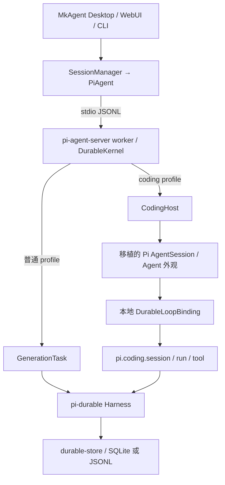

# Pi-durable coding agent 精简架构

MkAgent 已接入 pi-durable 内核，当前 coding profile 在已有 Harness 上运行 Pi coding 上层，普通 profile 保留 GenerationTask 路径。Coding 功能及插件契约已有实现和历史证据，完整程度仍须逐项核实。本次重点是核对独立包复用、薄外部适配及剩余源码移植的必要性，减少后续升级工作。pi-durable 负责执行调度与恢复，MkAgent 负责产品会话、权限和界面。工作顺序见[跟进清单](coding-follow-up.md)，功能证据见[需求对照](coding-acceptance.md)。

## 执行链路



[coding 包](../../packages/pi-durable-coding/package.json)独立于 MkAgent shared、server 和 UI，主要公开 `/native`、`/agent`、`/durable` 入口；[CodingHost](../../packages/pi-agent-server/src/coding-host.ts)把它接到产品 worker 已有的 Harness、工具目录和模型接口。

普通 profile 使用 `GenerationTask`；coding profile 保留 Pi `AgentSession` 的行为，通过 [DurableLoopBinding](../../packages/pi-durable-coding/src/durable-coding/engine.ts)执行 `pi.coding.session/run/tool` 等任务。两者使用同一执行内核。上游 `Agent` 的状态和 API 外观经过移植，循环入口已改接本地 durable 实现。

独立 SDK 也能使用这一边界，但默认后端为 `MemoryStorage`。需要跨进程恢复时，调用方须提供持久 Storage；产品 worker 已接入持久存储。

## 哪些直接引用上游包

以下是 coding 包和 [worker 包](../../packages/pi-agent-server/package.json)声明的 Pi 系直接生产依赖，均固定为 `1.5.0`；具体归属以两个 `package.json` 为准。

| 包 | 用途 |
|---|---|
| `@earendil-works/pi-durable` | Harness、任务、事务、存储和恢复 |
| `@earendil-works/pi-agent-core` | 公开协议类型、消息声明合并和 `streamProxy`；Agent 与循环入口仍由本地 durable 实现提供 |
| `@earendil-works/pi-ai` | 模型目录、provider、消息、流式请求和用量 |
| `@earendil-works/pi-mcp` | MCP 客户端与协议支持 |
| `@earendil-works/pi-codemode` | codemode 扩展与执行支持 |
| `@earendil-works/pi-tui` | Pi 交互组件、主题和终端接口 |
| `@earendil-works/pi-schema` | schema 与类型支持 |
| `@earendil-works/chord` | 结构化数据、执行上下文等基础能力 |

这两个包没有直接依赖完整 `pi-coding-agent`。Coding 包直接引用 core 的公开类型和代理传输，避免维护对应源码副本；`jiti`、`typebox`、`quickjs-wasi`、图像和文本处理等其他依赖也直接使用 npm 包，完整版本见 coding 包清单。

版本范围需要分开看：[根包](../../package.json)和 [shared](../../packages/shared/package.json)仍声明 `pi-ai@1.1.0`，不能把 coding 运行时的 `1.5.0` 写成全仓统一版本。

`pi-durable` 还通过根包的 `patchedDependencies` 应用[仓内补丁](../../patches/@earendil-works%252Fpi-durable@1.5.0.patch)，扩展 `GenerationTask` 的旧 coding 阶段、回调及类型声明。当前生产 `CodingHost` 通过本地任务执行；根 SDK 仍公开旧 `NativeCodingRuntime`，历史 checkpoint 也保留读取及拒绝不确定回放的迁移语义，因此本轮保留补丁。删除它须先完成兼容桥接及存量恢复验证。

## 哪些复制或移植了上游源码

两套移植均固定到 [Pi v1.5.0](https://github.com/earendil-works/pi/tree/f9a26365568127461c47a07a37dcb42c140a3ac5)，完整 revision 为 `f9a26365568127461c47a07a37dcb42c140a3ac5`。

下表路径相对于 `packages/pi-durable-coding/`。

| 本地位置 | 上游来源与移植方式 |
|---|---|
| `src/pi/**` | `packages/coding-agent/src/**` 的公开导入闭包，共 244 份 TypeScript 和 9 项主题、交互及 HTML 导出资源。保留 `AgentSession`、SDK、工具、扩展、资源和会话等实现；部分文件经过适配。 |
| `src/durable-agent.ts`、`src/stream-fn.ts` | 来自 `packages/agent/src/` 的 Agent 外观和 stream 支持。改写本地导入，并把 Agent 循环接到 durable 后端。`src/agent-runtime.ts` 和 `src/stream-proxy.ts` 已改为公开包适配，不再生成上游副本。 |
| `src/native-operations.ts` | 从上游 `agent-loop.ts` 选取 10 个请求、工具参数准备及结果处理函数。调度循环由本地任务实现。 |
| `src/rpc-ui.ts` | 从上游 RPC 类型中抽取扩展 UI 请求和响应声明，使宿主可单独引用协议。 |
| `src/upstream/**` | 另一套选择移植，共 13 项辅助与兼容源码，包括资源、扩展、会话视图及 durable context 函数；另有 21 个共享入口复用 `src/pi/**` 的同源实现。部分抽取指定声明、移除类型或调整导入。 |
| `test/fixtures/upstream/**` | 6 个原样测试夹具：5 个公开示例插件和 1 个 MCP OAuth 测试服务。 |

前四行合计为 [UPSTREAM-RUNTIME.json](../../packages/pi-durable-coding/UPSTREAM-RUNTIME.json) 的 248 份源码和 9 项资源，由 [vendor-coding-runtime.ts](../../packages/pi-durable-coding/scripts/vendor-coding-runtime.ts)生成。后两行合计为 [UPSTREAM.json](../../packages/pi-durable-coding/UPSTREAM.json) 的 19 项来源产物及 21 个共享入口，由 [vendor-upstream.ts](../../packages/pi-durable-coding/scripts/vendor-upstream.ts)生成。两套清单可能引用相同上游文件，计数代表本地产物。

这里的“移植”包含原样复制和可复现转换。清单记录原文件哈希、产物哈希及变更；转换覆盖 Agent 执行边界、宿主模型与凭据接口、项目信任、资源策略、工具回放、OAuth、插件解析及打包资源路径。转换规则保存在生成脚本及同目录的 `*-port.ts` 中。

上游复制部分保留 [MIT 许可](../../packages/pi-durable-coding/LICENSE.pi)，MkAgent 包声明为 Apache-2.0。构建时随依赖搬运的 WASM 等资源另行管理，不包含在上述 9 项 Pi 资源计数中。

## MkAgent 自有适配层与边界

`src/durable-loop.ts` 和 `src/durable-coding/**` 实现执行桥接、任务状态机、输入队列和 journal。[NativeSessionJournal](../../packages/pi-durable-coding/src/durable-coding/session-journal.ts)把原生会话条目、分支、输入身份和状态与任务 checkpoint 放进 durable 事务。[原生会话投影](../../packages/pi-agent-server/src/storage/native-session-projection.ts)及产品历史据此同步；投影失败会阻止继续发布，恢复不能只依赖一份普通聊天记录。对副作用不确定的阶段按回放策略拒绝自动重做，外部副作用不具备与本地事务一起提交的原子性。

`src/host-*.ts` 与 worker 的 `CodingHost` 接管路径、设置、模型接口、工具包装和 UI。`resourcePolicy: 'native' | 'host-only'` 控制自动资源发现，与执行模式分开；`host-only` 仍可使用显式宿主资源。项目扩展及 `.pi/mcp.json`、`.mkagent/mcp.json` 共用宿主信任决定，工具调用继续经过 MkAgent 审批。受信任 Node 插件拥有进程能力，工具审批不构成插件沙箱。

宿主压缩窗口由 `host-settings.ts` 包装公开 `SettingsManager` 接口，在内存中合成实际模型的 reserve tokens；原生设置实现不再带宿主策略补丁，reload 和 flush 不把该策略写入 Pi 配置。插件转译通过 Jiti 公开 transform 与 Babel 插件接口修正 Bun 的 `import.meta.dir/path/file`，按源文件提供元数据并隔离旧转译缓存；两个加载入口共用适配，保留宿主及插件的堆栈格式化。

插件保留 Pi 包名导入，由[原生虚拟模块表](../../packages/pi-durable-coding/src/pi/core/extensions/virtual-modules.ts)映射到本地移植 API 和独立官方包，也提供旧 `@mariozechner/*` 名称映射。这不要求安装完整 coding-agent 包。MkAgent 通过 RPC 承接扩展 UI；保留 Pi TUI 源码和依赖，不代表 MkAgent CLI 已采用原生 Pi TUI。插件兼容范围以需求对照中的实际验收为准。

Pi v1.5.0 尚未将 `AgentSession`、工具工厂、扩展与资源加载等 coding 层独立发布，完整包的 `createAgentSession` 固定创建上游 Agent，也没有公开的工厂执行器注入及版本化 snapshot/restore 接口。这些限制解释相关边界的移植需求，不能证明当前整个公开源码闭包都必须保留；F1 至 F3 逐类核对可替代实现和必要例外。durable 副作用和回调边界不能直接换成上游完整工具循环。公开包引用、策略外移和实现复用已减少部分差异，尚未达到仅更新版本号即可升级；生成与哈希追溯不能代替减少适配代码。

## 保留源码的依据与升级核对

本轮逐类核对后的边界如下。公开导入闭包是当前 SDK 导出面的依赖集合，不作为“所有文件都绝对必要”的证明；受限源码的具体内容仍未核验。

| 范围 | 决定与依据 | 升级时核对 |
|---|---|---|
| 协议类型与传输 | 使用 core 公开导出和 `streamProxy`。28 份文件恢复原版类型导入，Bun 产物逐份相同；只有 SDK、AgentSession 和虚拟模块表三处运行时导入改接 durable。 | 公开类型、消息声明合并、这三处执行入口 |
| Agent 外观及请求操作 | 上游 Agent 自己调用原版循环，没有公开的调度器注入点；10 个选取操作均为模块私有函数。公开 `runToolCall` 将准备、执行和 afterToolCall 合在一次调用中，缺少当前任务所需的分阶段 checkpoint 接口。保留外观移植与操作抽取，任务由 durable 调度。 | facade 状态、操作语义和任务恢复版本 |
| Coding 会话、扩展及展示 | 独立公开包未提供 AgentSession、coding loader 和 InteractiveMode；完整 coding 包只有根入口及 rpc-entry。当前 `./native` 保留完整 SDK 导出面，不能直接删掉其传递依赖而维持该入口。 | SDK 导出、插件事件、终端宿主及资源闭包；不把静态存在当行为验收 |
| 共享 helper 与宿主策略 | 21 个旧入口复用同一实现，18 个直接转发，3 个带外部策略。skills 和 prompt templates 固定旧入口的 `.pi` 目录，skills 还要求显式 agentDir；system prompt 用 30 行外部策略保留旧文档 URL、custom 和 forced prompt。shell 只转发旧公开名称。 | helper 导出、目录保护、来源归属、默认及自定义提示词 |
| 旧扩展入口 | 旧 loader 禁止上游 Agent 执行，runner 绑定 headless theme；原生入口提供 durable Agent 和 TUI。行为契约不同，不能直接互换整个 loader/runner；Bun 转译策略继续共用外部适配。 | 两种加载入口、失败回滚、元数据、类型边界 |
| 旧 package manager | 原生副本新增 resolutionPolicy、skip 结果和关闭等待语义，旧入口仍使用独立的 offline 资源包装。直接转发不是等价替换，本轮保留这一兼容副本，不将它标为已证明不可再收敛。 | 两种 resolve/update 返回及错误语义，先统一契约再去重 |
| 旧模型、设置、会话及上下文辅助 | 公开 pi-ai 模型集合已复用，provider 组合和配置值解析共用原生实现；旧 registry API、同步会话投影、设置合并和 boundary draft 等仍需不同的 facade 或私有方法抽取。durable context 选取支持同步预览，不能直接替换为异步提交后的 context 读取。 | `UPSTREAM.json` 的 13 项来源、选取声明、宿主端口及 journal 语义 |
| MCP OAuth、模型与打包适配 | MCP 协议和授权流程已用公开 pi-mcp；宿主持久化、跨进程刷新锁、取消、凭据接口及打包路径不由该公开协议包提供。受限凭据源码未读取，不对其内部必要性作完成声明。 | 主机生命周期、锁、取消、安装资源；受限项仍待核实 |
| durable 补丁 | 根 SDK 的 NativeCodingRuntime 和历史 checkpoint 仍依赖旧阶段，不能仅因新 CodingHost 已换用本地任务而删除。 | 旧 SDK 兼容和存量 checkpoint 迁移 |

原生 skills 和 prompt templates 原来只使用安装配置的项目目录常量，公开参数无法保留旧入口固定 `.pi` 的契约。共享函数各增加一个可选的项目目录参数，默认仍为原生目录；两个外部包装传入旧目录。两份源码共五处行替换，生成规则检查函数签名及三处目录表达式。独立复核发现的 `.tau` 回归已在新进程复现并修复，用例同时检查两套目录和显式资源的项目归属。

Provider 组合原来要求完整 `ModelConfig` 类，宿主现有调用方只提供 `getProvider`。该函数只读取这一个方法，完整类的私有状态无法由结构包装直接满足。保留一处类型参数接点，将约束收窄为 `Pick<ModelConfig, 'getProvider'>`，JavaScript 与原版相同。实际 `native-models.ts` 调用方先复现两处类型错误，修正后类型检查及声明构建通过；升级时核对该方法的输入输出和新增读取。

本轮 14 份重复 helper 归一后，旧入口净减少 3059 行；外部文档策略新增 30 行，合计净减少 3029 行实现。辅助移植由 27 项降为 13 项，共享入口由 7 个增至 21 个。类型导入内部改写的文件由 31 个降为 3 个，另保留上述两处目录参数和一处 provider 类型接点。248 份运行时源码的计数未变，不把这些收益写成移除了整个 coding 闭包。

## 复现与升级

辅助层检查使用上述 revision 的干净上游 checkout：

```sh
bun packages/pi-durable-coding/scripts/vendor-upstream.ts /absolute/pi-checkout --check
```

完整运行时的 `vendor-coding-runtime.ts --check` 和全量 Craft 审计会读取受限凭据源码，当前不得执行或重试，也不得通过其他脚本间接读取本地或上游的 `runtime-credentials.ts`。F5 保留阻塞，局部核对不等于完整复现。

修改获准范围的移植逻辑时，同步生成规则及来源记录，不绕过访问边界。升级时核对独立包版本、必要移植清单、MIT 许可和 durable 补丁，并按影响验证固定原版 Pi 对照、实际 worker、恢复及产品流程。
