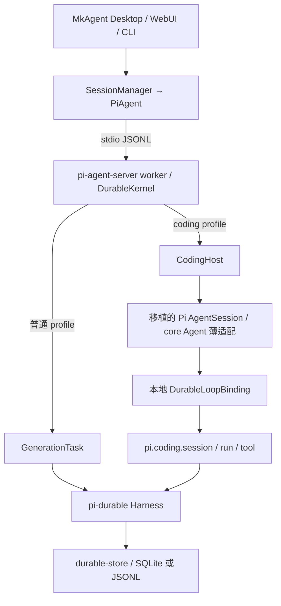

# Pi-durable coding agent 精简架构

MkAgent 已接入 pi-durable 内核，当前 coding profile 在已有 Harness 上运行 Pi coding 上层，普通 profile 保留 GenerationTask 路径。Coding 功能及插件契约已有实现和历史证据，完整程度仍须逐项核实。本次按接入 SDK 的方式二次开发，优先使用 pi-durable 及独立公开包的接口和扩展点，通过外部薄适配连接协议；只有仍不满足既定契约时，才修改上游 SDK 源码。收益按升级核对和适配维护量判断。pi-durable 负责执行调度与恢复，MkAgent 负责产品会话、权限和界面。工作顺序见[跟进清单](coding-follow-up.md)，功能证据见[需求对照](coding-acceptance.md)。

## 执行链路



[coding 包](../../packages/pi-durable-coding/package.json)独立于 MkAgent shared、server 和 UI，主要公开 `/native`、`/agent`、`/durable` 入口；[CodingHost](../../packages/pi-agent-server/src/coding-host.ts)把它接到产品 worker 已有的 Harness、工具目录和模型接口。

普通 profile 使用 `GenerationTask`；coding profile 保留 Pi `AgentSession` 的行为，通过 [DurableLoopBinding](../../packages/pi-durable-coding/src/durable-coding/engine.ts)执行 `pi.coding.session/run/tool` 等任务。两者使用同一执行内核。Agent 的状态和 API 外观通过独立 core 类复用，Native 薄适配将执行入口固定到本地 durable 实现。

独立 SDK 也能使用这一边界，但默认后端为 `MemoryStorage`。需要跨进程恢复时，调用方须提供持久 Storage；产品 worker 已接入持久存储。

## 哪些直接引用上游包

以下是 coding 包和 [worker 包](../../packages/pi-agent-server/package.json)声明的 Pi 系直接生产依赖，均固定为 `1.5.0`；具体归属以两个 `package.json` 为准。

| 包 | 用途 |
|---|---|
| `@earendil-works/pi-durable` | Harness、任务、事务、存储和恢复，以及生产宿主已安装的 `/codemode`、`/tool-search`、`/tools`、`/images` 内置模块 |
| `@earendil-works/pi-agent-core` | 公开协议类型、消息声明合并、`streamProxy`、Agent 状态与事件处理，以及十个请求与工具操作。四文件补丁提供操作导出和执行接点；Native Agent 薄适配固定使用 durable 调度 |
| `@earendil-works/pi-ai` | 模型目录、provider、消息、流式请求、用量、内存模型存储、枚举 schema 内容、usage 总数及公开取消和等待 helper；旧接口保留所需的类型、signal 与取消错误适配 |
| `@earendil-works/pi-mcp` | MCP 客户端与协议支持 |
| `@earendil-works/pi-codemode` | QuickJS 沙箱，作为 durable codemode 的执行后端 |
| `@earendil-works/pi-tui` | Pi 交互组件、主题和终端接口 |
| `@earendil-works/pi-schema` | schema 与类型支持 |
| `@earendil-works/chord` | 结构化数据、执行上下文等基础能力 |

这两个包没有直接依赖完整 `pi-coding-agent`。Coding 包直接引用 core 的公开类型和代理传输，避免维护对应源码副本；`jiti`、`typebox`、`quickjs-wasi`、图像和文本处理等其他依赖也直接使用 npm 包，完整版本见 coding 包清单。

内存模型存储通过同名 Native 子类继承公开 `InMemoryModelsStore`，保留已测克隆、取消和子类调用，方法所属原型及基类身份有所变化。Native `StringEnum` 保留自己的 `TUnsafe` 签名和 TypeBox 实例，包装公开 builder，保留非枚举标记、数组克隆及字面量推导。上下文 usage 总数直接引用 `pi-ai/utils/estimate`。三份源码共减少 34 行；生成规则按原声明摘要拒绝上游漂移。

无 Native journal 的 Agent 冷恢复从实际 checkpoint 重建消息数组，普通新任务保留原有消息对象；journal 路径继续由原身份映射负责。恢复先核对任务存在性、种类和会话，再确认初始历史已持久化，避免后续 prompt 重复写入。绑定回调抛错时也释放活动执行状态。真实 SIGKILL 只覆盖该独立 Agent 的工具执行边界，不代替完整产品与 Native journal 恢复验收。

实际任务记录的回归拒绝其他会话与错误种类，同时接纳本会话的 session 子任务，未要求其直接归会话所有。子任务测试在绑定回调处终止；同一已装载 Agent 的已完成任务也能加入且不再请求模型。这些检查验证恢复入口的校验，不替代完整会话生命周期。

ZIP 写入已转发到[归档适配](../../packages/pi-durable-coding/src/compat/archive.ts)。`fflate@0.8.2` 负责 ZIP 文件记录和目录，原有 DEFLATE 与 CRC 继续使用 Node 标准库。公开 `ZipInputFile` 接口保留输入顺序和重复文件名，也避免为每个条目保留压缩窗口。工具安装器等待 `JSZip@3.10.1` 完成 CRC 校验和普通文件解包，保留二进制查找、安装及清理流程。JSZip 规范化后保留同名的最后条目；适配要求独立空目录，在写入前检查保留条目的路径和文件类型。被覆盖的原始条目及实际 Windows 行为边界见[验证记录](coding-validation.md)。

Native EXIF 方向处理已转发到[图像方向适配](../../packages/pi-durable-coding/src/compat/image-orientation.ts)。durable 补丁开放既有的元数据读取和像素转置 helper，Native 兼容参数保留 WebP 块边界、短块前缀判断、有符号块长度及小端 TIFF 偏移，默认解析行为保持原样。适配继续使用 Photon Node 0.3.4，保留翻转时的对象身份和转置时由调用方释放旧对象的契约。

Native 缩放核心也转发到[缩放适配](../../packages/pi-durable-coding/src/compat/image-resize.ts)。编码与逐步缩小由 durable 共用循环负责，回调继续调用 Native Photon；兼容参数保留原质量阶梯、PNG/JPEG 选择和严格大小比较。适配保留分步尺寸取整、原字节早退、结果元数据及 worker 协议，既有 Photon 加载和发布资源位置继续使用 Native 路径。原包默认工厂与 Native 各有独立旧结果基线。同步 PNG 核心继续直接调用公开 Photon，durable 薄包装的 14 组对照没有发现可减少的算法，终端注册和完整发布布局仍未动态验证，具体范围见[验证记录](coding-validation.md)。

规范依赖补丁现在包含 30 个文件，首行记录后续正文按 LF 换行计算的完整 SHA-256。更新补丁时须同步摘要；回归用例检查两者一致，以免复用旧 Bun 缓存产物。当前 30 个文件已在独立缓存的冻结安装中逐一核对，较早版本的既有缓存验证范围见[验证记录](coding-validation.md)。

Native 图像 MIME 识别通过[类型适配](../../packages/pi-durable-coding/src/compat/image-mime.ts)共用 durable 的既有头部解析算法。适配仅保留未识别时的 `null` 和文件前 4100 字节的读取窗口，完整文件读取器的 APNG 扫描范围与原生入口不同，因此继续使用内核的字节检测函数。终端和剪贴板入口继续调用原名称。

Native ANSI 完整匹配通过[薄适配](../../packages/pi-durable-coding/src/compat/ansi.ts)引用 `ansi-regex@6.2.2`，仅补齐私有 CSI 前缀，并在同一次替换中处理所有匹配，避免删除后拼成新序列。原入口保留类型错误、快速路径和 256 个 UTF-16 码元的流式残片上限，两个导出函数的正文与上游相同。该公开包没有传递依赖，旧调用方继续解析到原来的 `ansi-regex@5.0.1`，具体对照和冻结安装范围见[验证记录](coding-validation.md)。

Native 子进程等待通过[薄适配](../../packages/pi-durable-coding/src/compat/child-process.ts)共用 durable 的既有算法。等待函数及类型通过 `env/node` 补丁公开，算法正文保持原样。适配保留 Native 的退出码返回值和原来的无写盘队列等待策略，100ms 输出空闲期限、持续输出续期、继承管道释放及监听器清理由内核负责。进程启动继续使用 Node 和 Windows `cross-spawn`，不另建执行环境或调度循环。

Native shell 的 Bash 传参选择和进程树清理也通过[薄适配](../../packages/pi-durable-coding/src/compat/shell.ts)共用 durable 的既有函数。Native 保留同步查找、错误、PowerShell、环境和 detached 子进程集合；macOS 的组 `SIGSTOP` 策略在适配中保留，后续清理由内核执行。`env/node.js` 相对原包仅增加三个函数的公开导出，全部算法正文不变。局部生成检查和冻结消费证据见[验证记录](coding-validation.md)。

Native 同步与异步读取路径通过[薄适配](../../packages/pi-durable-coding/src/compat/read-path.ts)共用 durable 的候选生成器。截图空格、NFD 和弯引号规则只保留一份；Native 仍按需计算候选，跳过与原路径相同的候选，并保留其他候选间的重复探测。durable 默认入口仍先生成全部候选，再用 `Set` 去重。生成器默认复用首次 NFD，durable 显式选择重新计算，保留其原来的两次调用及首次探测前的错误。两种入口继续使用各自的路径解析和存在性检查。

Native 头部截断、大小显示和默认上限共用 durable，尾部截断使用原有公开 `chord/output`。[薄适配](../../packages/pi-durable-coding/src/compat/truncate.ts)保留 Native 的行或字节标记、空行、限制 getter 顺序、错误和代理码元策略，并在调用 SDK 前选择候选行及 UTF-16 后缀。行计数策略留在外部适配层，两个 SDK 截断文件已恢复为原始缓存内容，durable 补丁由 30 文件降为 28；其余 26 份差异不变。生成转换检查尾部公开签名和剩余引用，不要求同步核对已替换的算法正文或无引用私有 helper 的签名。中间和单行处理仍保留原文。两个运行时的原版行为、冻结消费者及首调用开销见[验证记录](coding-validation.md)。

Native [编辑差异入口](../../packages/pi-durable-coding/src/pi/core/tools/edit-diff.ts)通过 9 个公开函数共用 durable 的匹配、替换、换行和 diff 算法，18 个重复算法正文被移除。Native 保留自己的函数签名和类型声明，插件接口扩展仍作用于返回类型；文件解析、读取权限、BOM、预览和错误转换继续由原来的两个预览函数负责，正文不变。内核仅新增公开导出，既有算法及类型不变；两套 diff 的 19 份运行时文件一致。源码由 556 行降为 186 行，原版结果、真实文件预览及冻结消费者范围见[验证记录](coding-validation.md)。

版本范围需要分开看：[根包](../../package.json)和 [shared](../../packages/shared/package.json)仍声明 `pi-ai@1.1.0`，不能把 coding 运行时的 `1.5.0` 写成全仓统一版本。

宿主的 `tools/codemode.ts` 直接调用 durable 的 `createCodemodeExtension`，`index.ts` 安装内置 `createToolSearchExtension`；`tools/builtin.ts` 使用 durable 的编码工具、PowerShell 和图像工厂。`CodingHost` 将 registry 中的注册转换为原生工具，并通过 `baseToolsOverride` 注入 coding 会话。上述装配已有实现，本轮补充核实。

真实沙箱回归发现 Worker 回调丢失异步上下文，导致桥接提交报错。`currentCodingToolInvocation()` 现在捕获当前上下文，使后续提交回到原来的工具和 journal 作用域；codemode 的执行、日志和子任务仍使用 durable 内置实现。三项集成检查覆盖子工具审批与归属、model-only 限制及 tool-search 启用回调。完整 AgentSession 的声明更新、分支和恢复不在这三项检查范围内。

SDK 的 tool-search 已共用 durable 的分词、BM25 和 schema 元数据遍历。仓内补丁为现有核心增加兼容导出，提供 SDK 所需的分数、可配置 `k1/b` 和元数据文本；内置工具仍调用同一排序核心，默认行为保持原样。SDK 保留 namespace 独立字段、注册和会话启用接口，不另行维护排序算法。兼容导出属于本地补丁，升级须重放补丁并运行原版排序对照。

原生 codemode 入口现已转发到 `src/compat/codemode-native.ts`，原来的独立执行循环已删除。VM 执行、调用日志、四个模型并发槽及结果提交由 durable 内置执行器负责。Native 适配保留字符串调用 ID、实时行、模型目录、发现元数据、分支 store 和文件写入策略；输出仍共用内置 formatter，保留此前 96 个原版格式化对照场景的证据。

一个隐藏转发工具把 VM 调用接到真实官方子任务，再由 Native `ctx.executeTool` 进入既有工具管道。它保留实际 task ID、owner、调用 key 和审批回调，不伪造 Native invocation。私有注册名固定从原工具名派生，目录变化不能改变旧调用的目标，无须另存别名表。转发 token 使用 memo 的持久胜出值，同一 owner 只允许一个活动租约。回执保存 Native 行元数据，重用已完成结果时恢复 ID、状态与展示 usage；已记录的准备拒绝也不会重新查询模型目录。用量去重标记在 Native 任务中保存为收据元数据，读取时恢复，保留严格 JSON 边界及 wrapper spread。

Native store 首次读取和最终写回分别进入 `run.start` 与 `run.result` 的事务；配置适配器后不写内置会话 store。实际 Native 入口与真实分支 journal 的检查覆盖分支切换、原始写入、无 append、结果重用、脚本错误、回调拒绝及存储拒绝。存储错误终止 Harness，不在同一会话自动重试。沙箱适配保留 256 MiB、默认两个 worker、FIFO 和等待期限，实际 worker 退出后才释放名额。上述边界已有定向证据，完整插件加载、产品入口及进程崩溃恢复仍未重新验证；Native 父工具默认的 unsafe 回放规则保持不变。

`pi-durable` 通过根包的 `patchedDependencies` 应用[仓内补丁](../../patches/@earendil-works%252Fpi-durable@1.5.0.patch)，包含旧 `GenerationTask` coding 阶段、回调、类型声明及上述搜索和输出兼容接点。当前生产 `CodingHost` 通过本地任务执行；根 SDK 仍公开旧 `NativeCodingRuntime`，历史 checkpoint 也保留读取及拒绝不确定回放的迁移语义。删除旧阶段部分须先完成兼容桥接及存量恢复验证；搜索和输出接点单独保留升级核对。

补丁统一由干净依赖生成标准 Git diff。Native codemode 阶段的 18 个文件通过干净缓存重放及全新消费者的离线 frozen install 字节核对；安装禁用 lifecycle scripts，系统沙箱拒绝网络，锁文件未变。该阶段消费者通过 29 项测试、150 个断言，当前补丁的 30 文件核对见验证记录。兼容接点仍属于仓内补丁，升级须同时核对补丁重放、新安装和 Native 行为，不能只核对已修改的安装副本。

## 哪些复制或移植了上游源码

两套移植均固定到 [Pi v1.5.0](https://github.com/earendil-works/pi/tree/f9a26365568127461c47a07a37dcb42c140a3ac5)，完整 revision 为 `f9a26365568127461c47a07a37dcb42c140a3ac5`。

下表路径相对于 `packages/pi-durable-coding/`。

| 本地位置 | 上游来源与移植方式 |
|---|---|
| `src/pi/**` | `packages/coding-agent/src/**` 的公开导入闭包，共 244 份 TypeScript 和 9 项主题、交互及 HTML 导出资源。保留 `AgentSession`、SDK、工具、扩展、资源和会话等实现；部分文件经过适配。 |
| `src/durable-agent.ts`、`src/stream-fn.ts` | Agent 由 662 行移植实现改为 115 行 core 子类，保留 durable 队列身份、恢复和独立默认值。三个默认声明仍从锁定上游提取；stream 模块保留独立注册状态。`src/agent-runtime.ts` 和 `src/stream-proxy.ts` 使用公开包适配。 |
| `src/native-operations.ts` | 24 行门面，调用 core 包公开的 10 个请求、工具参数准备及结果处理函数。保留 Native 默认身份对象，调度循环由本地任务实现。 |
| `src/rpc-ui.ts` | 从上游 RPC 类型中抽取扩展 UI 请求和响应声明，使宿主可单独引用协议。 |
| `src/upstream/**` | 6 项选取源码：旧扩展 loader、Git 路径、上下文文件、资源去重、boundary drafts 和同步 durable context；另有 28 个共享入口。资源纯函数也由原生模块复用，不保留第二份算法。 |
| `test/fixtures/upstream/**` | 6 个原样测试夹具：5 个公开示例插件和 1 个 MCP OAuth 测试服务。 |

前四行合计为 [UPSTREAM-RUNTIME.json](../../packages/pi-durable-coding/UPSTREAM-RUNTIME.json) 的 248 份源码和 9 项资源，由 [vendor-coding-runtime.ts](../../packages/pi-durable-coding/scripts/vendor-coding-runtime.ts)生成。后两行合计为 [UPSTREAM.json](../../packages/pi-durable-coding/UPSTREAM.json) 的 12 项来源产物及 28 个共享入口，由 [vendor-upstream.ts](../../packages/pi-durable-coding/scripts/vendor-upstream.ts)生成。两套清单可能引用相同上游文件，计数代表本地产物。

三处 pi-ai 收敛前的静态快照覆盖其中 245 份 TypeScript，按逐项核验的路径读取本地与上游源码。忽略注释和模块目标后，206 份语法相同，4 份生成的 JavaScript 相同，35 份仍有差异；3 个解析边界保持未分类。模块目标核对另确认 1014 个相对引用指向同源登记，484 个包或标准库引用不变，5 个模块增强不变。Agent 循环、AgentSession 的工具执行和插件 core 命名空间有意改接本地 durable；仅余的未登记相对类型重写是 stream 模块的公开 `StreamFn` 别名。这些分类不作为最新计数，也不证明完整行为等价或全部源码必要。

三个运行模式已恢复上游的 `process.off` 写法，文件与锁定上游逐字节一致，来源记录不再包含转换。已有 `node-process.d.ts` 负责环境类型补充，生成器不再改写运行时调用，也删除了一条无效的相同字符串替换。窄范围类型、真实监听器清理及定向生成范围见[验证记录](coding-validation.md)。

请求及工具操作不再复制函数正文。core 补丁仅修改发布的 JavaScript 和类型声明，公开十个已有函数，并为流式请求补充可选默认身份参数。Native 保留原来的身份对象，其他九个函数直接转发。独立消费者须同时应用根目录登记的 durable 与 core 补丁。原版 58 场景、真实 durable task 入口和新冻结消费者通过；类型证据仅覆盖协议投影，完整 SDK 边界继续受限。

Agent 的状态初始化、提示输入、事件归约、取消和等待也改由 core 类处理，Native 仅保留 durable 接点。core 的新增运行时正文净增加 4 行，不将原有类复制进补丁。执行后端以普通私有字段保存，保留透明 `Proxy` 的接收者行为；最初的 `#private` 原型在新增回归中失败，已修正。最终原版对照在 Bun、Node 下各通过 27 组，未调用上游 loop；冻结消费者及完整验证边界见[验证记录](coding-validation.md)。

Native 实例仍满足 `instanceof Agent`，现在也满足 `instanceof CoreAgent`。两个构造函数的 `length` 均保留为 1；core 新增参数使用默认值，避免改变原有参数个数。私有字段和原型反射布局有变化，定向行为对照不代表这些内部布局完全相同。

`src/legacy/**` 单独维护 7 份宿主兼容策略。旧包管理、消息、模型、设置、token、会话及 runner 路径只生成转发，生成器不再保存这些策略的第二份文字模板。它们复用移植实现，不计为直接引用独立公开包。

这里的“移植”包含原样复制和可复现转换。清单记录原文件哈希、产物哈希及变更；转换覆盖 Agent 执行边界、宿主模型与凭据接口、项目信任、资源策略、工具回放、OAuth、插件解析及打包资源路径。转换规则保存在生成脚本及同目录的 `*-port.ts` 中。

上游复制部分保留 [MIT 许可](../../packages/pi-durable-coding/LICENSE.pi)，MkAgent 包声明为 Apache-2.0。构建时随依赖搬运的 WASM 等资源另行管理，不包含在上述 9 项 Pi 资源计数中。

## MkAgent 自有适配层与边界

`src/durable-loop.ts` 和 `src/durable-coding/**` 实现执行桥接、任务状态机、输入队列和 journal。[NativeSessionJournal](../../packages/pi-durable-coding/src/durable-coding/session-journal.ts)把原生会话条目、分支、输入身份和状态与任务 checkpoint 放进 durable 事务。[原生会话投影](../../packages/pi-agent-server/src/storage/native-session-projection.ts)及产品历史据此同步；投影失败会阻止继续发布，恢复不能只依赖一份普通聊天记录。对副作用不确定的阶段按回放策略拒绝自动重做，外部副作用不具备与本地事务一起提交的原子性。

同一事务内重复准备 journal 时，只应用该阶段尚未准备的操作；事务草稿 nonce 识别已准备前缀，回滚后的新事务从完整待提交操作重试。宿主工具 commit 在捕获的调用作用域执行回调，并在回调前后 flush，使回调新增原生条目与宿主文档共享回执。条目直到存储确认才进入已提交视图，回调自身的外部副作用仍由宿主管理。

`src/host-*.ts` 与 worker 的 `CodingHost` 接管路径、设置、模型接口、工具包装和 UI。`resourcePolicy: 'native' | 'host-only'` 控制自动资源发现，与执行模式分开；`host-only` 仍可使用显式宿主资源。项目扩展及 `.pi/mcp.json`、`.mkagent/mcp.json` 共用宿主信任决定，工具调用继续经过 MkAgent 审批。受信任 Node 插件拥有进程能力，工具审批不构成插件沙箱。

宿主压缩窗口由 `host-settings.ts` 包装公开 `SettingsManager` 接口，在内存中合成实际模型的 reserve tokens；原生设置实现不再带宿主策略补丁，reload 和 flush 不把该策略写入 Pi 配置。插件转译通过 Jiti 公开 transform 与 Babel 插件接口修正 Bun 的 `import.meta.dir/path/file`，按源文件提供元数据并隔离旧转译缓存；两个加载入口共用适配，保留宿主及插件的堆栈格式化。

插件保留 Pi 包名导入，由[原生虚拟模块表](../../packages/pi-durable-coding/src/pi/core/extensions/virtual-modules.ts)映射到本地移植 API 和独立官方包，也提供旧 `@mariozechner/*` 名称映射。这不要求安装完整 coding-agent 包。MkAgent 通过 RPC 承接扩展 UI；保留 Pi TUI 源码和依赖，不代表 MkAgent CLI 已采用原生 Pi TUI。插件兼容范围以需求对照中的实际验收为准。

Pi v1.5.0 尚未将 `AgentSession`、工具工厂、扩展与资源加载等 coding 层独立发布，完整包的 `createAgentSession` 固定创建上游 Agent，也没有公开的工厂执行器注入及版本化 snapshot/restore 接口。这些限制解释相关边界的移植需求，不能证明当前整个公开源码闭包都必须保留；F1 至 F3 逐类核对可替代实现和必要例外。durable 副作用和回调边界不能直接换成上游完整工具循环。公开包引用、策略外移和实现复用已减少部分差异，尚未达到仅更新版本号即可升级；生成与哈希追溯不能代替减少适配代码。

## 保留源码的依据与升级核对

本轮逐类核对后的边界如下。公开导入闭包是当前 SDK 导出面的依赖集合，不作为“所有文件都绝对必要”的证明；受限源码的具体内容仍未核验。

| 范围 | 决定与依据 | 升级时核对 |
|---|---|---|
| 协议类型与传输 | 使用 core 公开导出和 `streamProxy`。28 份类型导入在 `f2b90d5` 恢复时验证 JavaScript 未变。允许范围内已核对 AgentSession 与虚拟模块表的 durable 运行时转接；SDK 的具体接线保持不透明边界。 | 公开类型、消息声明合并、执行入口及 SDK 受限接线 |
| Agent 外观及请求操作 | core 四文件补丁公开十个操作，并允许 Agent 注入执行后端及必要的受保护接点。115 行 Native 子类复用 core 的状态和生命周期，固定注入 durable；24 行操作门面保留 Native 默认身份。队列只暴露所需操作，活动状态只暴露只读标记，默认对象及 stream 注册仍独立。 | core 接点、默认对象、透明 Proxy、事件等待、队列身份和任务恢复版本 |
| Native codemode | 内置执行器、模型准备和 formatter 已复用。公开选项承接 store、租约、发现覆盖、调用观察和结果投影；外层保留 Native 字符串 ID、实时展示、原始分支写入及 worker 策略。隐藏转发器使动态 Native 工具走实际子任务和既有审批管道，不另建执行循环。 | 公开接点、工具及模型目录变化、Native 行与用量、取消、journal 回执及沙箱释放 |
| Coding 会话、扩展及展示 | 独立公开包未提供 AgentSession、coding loader 和 InteractiveMode；完整 coding 包只有根入口及 rpc-entry。当前 `./native` 保留完整 SDK 导出面，不能直接删掉其传递依赖而维持该入口。 | SDK 导出、插件事件、终端宿主及资源闭包；不把静态存在当行为验收 |
| 共享 helper 与宿主策略 | 28 个旧入口共用实现，18 个直接转发，10 个保留外部策略。skills、prompt templates 和包管理固定旧入口的 `.pi` 目录；system prompt 保留宿主文档 URL。JavaScript 兼容边界保留原有宽输入与返回值。 | helper 导出、目录保护、结构类型、默认及自定义提示词 |
| Native 写入与流式输出 | 写入薄适配在两个运行时各保留 18 个场景，但仍需完整 Native 文件操作及队列策略。输出窗口的 raw 选项仍改变 23 组中间状态；保留原裁剪策略后各有 165 组一致，但运行时正文由 200 行增至 203 行，还需新的 raw API。两者暂保留原版，范围见验证记录。 | 取得队列后的取消、未完成操作、部分行快照、日志原始字节和权限 |
| Native 读取文本分支 | 真实 durable 工具的兼容原型在两种运行时各有 31 组结果和取消轨迹一致，但增加代码并依赖私有 MIME 读取顺序。保留原定义；读取候选、MIME、图像算法和头部截断继续共用已有公开实现。 | BOM、首行超限、offset/limit、文件操作、取消和完整图像路径 |
| 旧扩展入口 | runner 共用原生实现，通过可选依赖绑定 headless theme 与宿主提示词，默认调用不变。loader 的虚拟模块映射及初始化状态为模块私有，公开加载参数不能注入旧入口的模块契约；保留该项源码转换。两个入口共用 Bun 转译适配。 | 两种加载入口、失败回滚、元数据、theme 和文档 URL |
| 旧 package manager | 共用原生实现，旧入口只适配目录、离线回调和 skipped 结果。共享构造参数默认保持原生目录；设置参数只要求实际使用的六个方法，兼容现有结构对象。 | 两种 resolve/update 返回、离线回调、项目目录及错误语义 |
| 旧模型、设置、会话及 token | registry 继承共享外观，设置合并和 token 估算共用原生函数。会话存储、迁移、索引、分支及工厂共用原生类；可选投影策略保留 durable head、贡献消息与已折叠编辑，默认仍为原生规则。 | 静态及脱离类调用、实例类型、JSONL 迁移、消息身份、旧 usage 失效、声明输出 |
| 资源与上下文选取源码 | Git、上下文文件与资源去重未由独立公开包提供，选取成轻量共享实现，原生和旧入口均调用它们。boundary drafts 使用 AgentSession 私有方法；同步 durable 预览使用 harness 私有纯函数，不能用异步提交后的读取替代。只保留这些指定声明。 | 三份纯函数的双入口调用、信任默认值、private 方法及同步预览语义 |
| MCP OAuth、模型与打包适配 | MCP 协议和授权流程已用公开 pi-mcp；宿主持久化、跨进程刷新锁、取消、凭据接口及打包路径不由该公开协议包提供。受限凭据源码不在本次允许核实的范围，不对其内部必要性作完成声明。 | 主机生命周期、锁、取消、安装资源；受限项仍待核实 |
| durable 补丁 | 根 SDK 的 NativeCodingRuntime 和历史 checkpoint 仍依赖旧阶段，不能仅因新 CodingHost 已换用本地任务而删除。 | 旧 SDK 兼容和存量 checkpoint 迁移 |

静态源码图外另有五项，不能作为删除清单。两个 worker 由配置路径和图片处理的 URL 加载，highlight 声明补齐 `.js` 子路径及语言通配符类型。`client-identity.ts` 保留版本及 telemetry 决定，`remote-catalog-provider.ts` 保留目录版本、ETag、离线恢复与个性化发布策略；本轮没有调用其中的网络或身份逻辑。后两项在允许图中没有调用边，是否可移除仍须核实不透明 SDK 与模型入口。公开凭据协议也不能直接替代 Native 同步及异步原始 JSON 锁回调；现实现已使用 `proper-lockfile` 和标准文件 API，其调用方与受限编排仍未整体核实。

内存原始后端另做了公开 `InMemoryCredentialStore` 排队适配。保留同步原始值、结果 Promise 等待及 Native 取消包装后，Bun 和 Node 的已测值与队列观察一致，但去类型和注释后的运行时正文仍是 26 行，已计新增 import。适配还需生成接点，没有减少维护正文，因此保留原版；这项判断不覆盖文件锁、只读校验和受限编排。

原生 skills 和 prompt templates 原来只使用安装配置的项目目录常量，公开参数无法保留旧入口固定 `.pi` 的契约。共享函数各增加一个可选的项目目录参数，默认仍为原生目录；两个外部包装传入旧目录。两份源码共五处行替换，生成规则检查函数签名及三处目录表达式。独立复核发现的 `.tau` 回归已在新进程复现并修复，用例同时检查两套目录和显式资源的项目归属。

Provider 组合原来要求完整 `ModelConfig` 类，宿主现有调用方只提供 `getProvider`。该函数只读取这一个方法，完整类的私有状态无法由结构包装直接满足。保留一处类型参数接点，将约束收窄为 `Pick<ModelConfig, 'getProvider'>`，JavaScript 与原版相同。实际 `native-models.ts` 调用方先复现两处类型错误，修正后类型检查及声明构建通过；升级时核对该方法的输入输出和新增读取。

`f2b90d5` 的 14 份 helper 归一净减少 3029 行实现，辅助源码由 27 项降为 13 项，共享入口由 7 个增至 21 个。该提交还将类型导入内部改写从 31 份降为 3 份。

前次辅助层收敛相对 `f2b90d5` 将辅助源码从 13 项降为 6 项，共享入口增至 28 个，并统一原生资源模块中的重复算法。当时按 `git diff --numstat`，23 个生产源码文件新增 342 行、删除 6379 行，净减 6037 行，已计入新增薄适配和共用类型。测试和生成规则另计。后续工具及图像算法共享的变化分别记录在上文和验证记录中，不计入这份历史统计。248 份运行时源码的完整必要性仍未核实。

## 复现与升级

已确认可共享的包管理、消息、模型、设置、会话、runner、token 及资源算法均已收敛。兼容策略维护在普通源码中；生成接点检查锚点和出现次数，上游结构变化时直接失败。共用类型从原生公开方法派生旧 JavaScript 输入边界，保留数组、基本类型和异步返回推断，不复制方法声明清单。严格消费者回归覆盖宿主消息字段、开放设置、结构化包设置及会话声明。F1/F3 对完整 SDK 闭包的必要性核实仍未完成，不能把未核实文件整体归入必要例外。

共享替换的适用路径、转换、来源标签及新增依赖统一登记在[共享规则](../../packages/pi-durable-coding/scripts/shared-helper-port.ts)。运行时生成器直接消费规则结果，新增共享替换不再同步维护筛选条件、标签选择和依赖条件。整模块转发的结构防护位于[转发转换](../../packages/pi-durable-coding/scripts/shared-runtime-port.ts)，声明替换保留原摘要防护；原有字符串接口继续可用。此次调整不改变运行时产物或来源清单。

辅助层检查使用上述 revision 的干净上游 checkout：

```sh
bun packages/pi-durable-coding/scripts/vendor-upstream.ts /absolute/pi-checkout --check
```

运行时提供 `--check --file=core/session-manager.ts` 等定向模式，只读显式文件，不展开导入依赖、不处理完整资源或 Agent 闭包，也不写清单。本轮逐项核验 realpath 和摘要后，复现了 241 份明确列出的 Coding 源码，全部产物和来源记录一致。路径校验现接受 `execute.lazy.ts` 等合法分段文件名；9 个空路径、越界、错误分段及受限名称输入仍被拒绝，输出为 `complete: false`。

其余四个 Agent 输出通过实际生成器片段核对，读取端口只允许四个指定上游输入。9 项静态资源分别核对复制字节、来源摘要和记录，锁定许可也一致。累计覆盖 245 份允许 TypeScript 和 9 项资源，未执行完整生成器；三个不透明入口及完整依赖、core 导入汇总继续排除。

完整运行时的 `vendor-coding-runtime.ts --check` 和全量 Craft 审计会读取受限凭据源码，当前不得执行或重试，也不得通过其他脚本间接读取本地或上游的 `runtime-credentials.ts`。F5 保留阻塞，局部核对不等于完整复现。

修改获准范围的移植逻辑时，同步生成规则及来源记录，不绕过访问边界。升级时核对独立包版本、必要移植清单、MIT 许可和 durable 补丁，并按影响验证固定原版 Pi 对照、实际 worker、恢复及产品流程。
